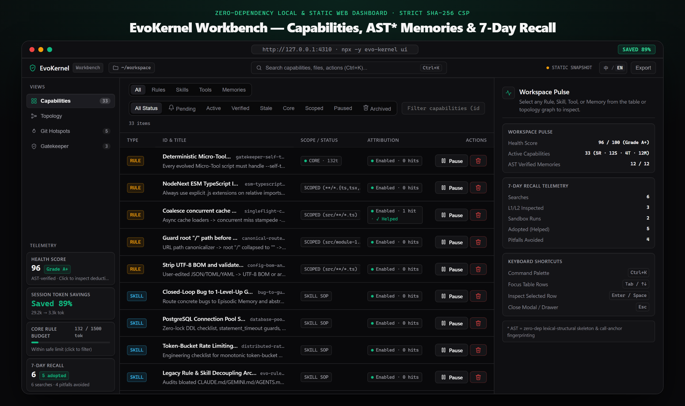

<div align="center">

# 🧬 EvoKernel (evo-kernel)

### Stop Repeating the Same Bug Across Coding Sessions — AST-Verified Cognitive Memory & 6-Stage Deterministic Gatekeeper, with 88.7% Lower Session-Start Token Tax and 0 External Dependencies.

**The Deterministic Self-Evolving Meta-Kernel & Cognitive Context OS for AI Coding Agents**  
*Claude Code · Cursor · Codex · Windsurf · Cline · Roo · GitHub Copilot · OpenCode · Gemini · Antigravity*

[](https://github.com/damonless/EvoKernel/actions/workflows/ci.yml)
[](https://damonless.github.io/EvoKernel/demo/)
[-34d399?style=flat-square)](#-30-second-quick-start)
[](https://www.npmjs.com/package/evo-kernel)
[](LICENSE)
[](https://nodejs.org/)
[-brightgreen?style=flat-square)](#-zero-dependency-architecture)
[](#-core-architecture-5-fixed-meta-tools)
[](#-comprehensive-verification-suite)

**[English](README.md) · [简体中文](README.zh-CN.md) · [🌐 Product Site](https://damonless.github.io/EvoKernel/) · [🖥️ Interactive Workbench Demo](https://damonless.github.io/EvoKernel/demo/) · [📊 Benchmarks](benchmarks/README.md)**

<br/>

<a href="https://damonless.github.io/EvoKernel/"></a>

</div>

> **What is EvoKernel?** EvoKernel gives your AI coding agent **cross-session AST-verified cognitive memory, visible 1-line recall receipts (`🛡️ EvoKernel Recall`), and a 6-stage deterministic Gatekeeper** so fixed bugs stay fixed across sessions — while folding sprawling MCP tool schemas and monolithic rule files behind 5 fixed meta-primitives (**-88.7% session-start token tax: `27,150 → 3,066` tok/turn, 100% KV cache hit, 0 external dependencies**).

> [!NOTE]
> **Disambiguation Note:** EvoKernel (`evo-kernel`) is an agent architecture and context engineering framework for AI coding assistants (Claude Code, Cursor, Windsurf, Codex, Gemini, etc.). It is not affiliated with academic ICML papers/benchmarks of similar naming or Linux kernel projects.

---

## ⚡ 30-Second Quick Start

Get started in 3 commands — zero installation required:

```bash
# 1. Instant Zero-Write X-Ray (<25ms) — scan host rules, git hotspots & memory coverage
npx -y evo-kernel score

# 2. One-Click Safe Wiring & Doctor Check — wire 10 IDEs safely with stealth mode
npx -y evo-kernel init --stealth && npx -y evo-kernel doctor
# (Preview MCP virtualization token savings safely with: npx -y evo-kernel virtualize --dry-run)

# 3. Launch EvoKernel Workbench to inspect capabilities, AST memories & 7-day recall
npx -y evo-kernel ui
```

> 💡 **Node.js 18 / 20 Instant 1-Liner (No Global Node Upgrade Needed):**  
> `npx -y -p node@22 evo-kernel score`  
> *(Note: `npx -p node@22` is recommended for one-off CLI diagnostics. For a persistent background MCP service, upgrade system Node to `>= 22.5.0` via `nvm install 22 && nvm use 22` or `fnm use 22`, and install globally via `npm install -g evo-kernel`.)*  
> *Why Node.js >= 22.5.0?* EvoKernel runs purely on native `node:sqlite`, `node:module`, and `node:test` — providing **0 external npm dependencies and 0 supply-chain vulnerability risk**.

<details>
<summary><b>🖥️ Visual Tour: 3-Act CLI Pipeline, EvoKernel Workbench &amp; Terminal X-Ray (Click to expand)</b></summary>

<br/>

<div align="center">
  
</div>

<br/>

<table>
<tr>
<td align="center" width="56%">
  <b>EvoKernel Workbench (<code>npx evo-kernel ui</code>)</b><br/>
  <a href="https://damonless.github.io/EvoKernel/demo/"></a>
</td>
<td align="center" width="44%">
  <b>Instant Terminal X-Ray (<code>npx evo-kernel score</code>)</b><br/>
  
</td>
</tr>
</table>

</details>

<details>
<summary><b>🛠️ Clone from Source, CI Deliverable Checks &amp; Advanced CLI Workflows (Click to expand)</b></summary>

```bash
# Clone and build from source (takes <50ms, zero npm install required)
git clone https://github.com/damonless/EvoKernel.git
cd EvoKernel
node ./scripts/build.mjs

# Wire L0 Meta-Rule Seed + Single Meta-MCP into your active coding agents
node ./dist/cli/index.js init --targets auto --stealth

# Cold-start mine your repository structure, project stacks & Git fix history
node ./dist/cli/index.js bootstrap --max-commits=50

# Run offline worktree optimization cycle
node ./dist/cli/index.js optimize --dim both -k 3

# CI / Deliverable canonical inspection (.xlsx, .docx, .pptx, .csv, .json, .md)
npx -y evo-kernel check ./README.md

# Inspect capability tree, multi-branch AST memory freshness & live MCP handshake
node ./dist/cli/index.js tree
node ./dist/cli/index.js memory verify
node ./dist/cli/index.js doctor --roi
node ./dist/cli/index.js audit --global
```

</details>

---

## 🔒 Reversibility, Team Sharing & Privacy

EvoKernel is designed from the ground up to be safe to trial, transparent to inspect, and completely reversible at any moment:

### 1. What `evo init` Touches & 1-Command Lossless Uninstall
When you run `npx evo-kernel init`, it touches only three isolated surfaces:
- **Host Agent Rule Files**: Inserts a compact (<1,100 tok), bounded English managed block between `<!-- EVO:START -->` and `<!-- EVO:END -->` markers in detected configuration files (`CLAUDE.md`, `AGENTS.md`, `.cursor/rules/evo-kernel.mdc`, or `GEMINI.md` when `.gemini/` is present — avoiding duplicate root Markdown injection). Existing user rules outside these markers are untouched.
- **Host MCP Configs**: Registers a single stdio gateway entry for `evo-kernel` (leaving third-party servers untouched unless virtualized).
- **Workspace `.evo/` Tree**: Generates local capability and episodic memory directories (`.evo/rules/`, `.evo/skills/`, `.evo/memories/`, `.evo/tools/`, `.evo/.cache/`).

To cleanly and completely revert your repository and agent configurations back to baseline, run:
```bash
npx -y evo-kernel virtualize --restore && npx -y evo-kernel uninstall
```
This restores any virtualized MCP servers to host configuration files, strips all `<!-- EVO:START -->` blocks cleanly, unwires registered lifecycle hooks, and removes `.evo/` with **zero left-behind configuration artifacts**.

### 2. Multi-Person Team Sharing vs. `--stealth` Mode
- **Multi-Person Team Sharing (Default `evo init`)**: Commit `.evo/rules/`, `.evo/memories/`, and `.evo/tools/` to your Git repository. Every team member and coding agent immediately benefits from shared root-cause bug fixes and verified sandboxed micro-tools, while internal cache files (`.evo/.cache/`) are automatically gitignored.
- **Personal Standalone Trial (`evo init --stealth`)**: Appends `.evo/` and modified host rule files to `.git/info/exclude`. Git completely ignores EvoKernel files locally without touching `.gitignore` or creating uncommitted working tree diffs in shared repositories. Zero git pollution.

### 3. 100% Local-First & Zero Outbound Telemetry
EvoKernel performs **0 outbound network requests**, transmits **0 analytics or telemetry**, and requires **0 external cloud APIs**. All SQLite FTS5 indexes and observable recall ledgers (`.evo/.cache/telemetry.db`) are stored 100% locally on your machine.

---

## 📈 50-Turn Context-Tax Analytical Model & Live Engine Micro-Benchmark (`npm run benchmark`)

Analytical cost/cache model across **8 standard MCP servers** (`github`, `playwright`, `kubernetes`, `docker`, `linear`, `postgres`, `sentry`, `context7` — **77 tools** total) + a mature repo knowledge base (10 rules, 4 skills, 5 micro-tools, 15 debugging memories) over a **50-turn coding session** with 3 mid-session capability evolutions, paired with live local engine micro-benchmarks (reproduce locally via `npm run benchmark`).
*Note on zero-prefix-invalidation condition*: The 0 mid-session cache invalidation guarantee holds when new capabilities are crystallized as `core: false` scoped rules, skills, micro-tools, or `memory` entries (the default in EvoKernel), which reside in `.evo/` without mutating the top-level `tools/list` schema or host `CLAUDE.md` L0 prefix.

| Metric | Raw Multi-MCP + Monolithic `CLAUDE.md` | **🧬 EvoKernel 5-Tool Meta-Gateway** | Model / Live Result |
| :--- | :---: | :---: | :---: |
| **Exposed Tool Schemas** | 77 tools (`14,700` tok) | **5 fixed meta-tools (`1,916` tok)** | **-93.5% schema count (`-87.0%` schema tok)** |
| **Session-Start Static Prefix / Turn** | 27,150 tokens | **3,066 tokens** | **-88.7% session-start token tax** |
| **Mid-Session Cache Invalidations** | 3 full prefix busts | **0 (100% cache hit)** | **100% KV Cache Shield** |
| **50-Turn Cumulative Prompt Tokens** | 1,931,250 tokens | **738,570 tokens** | **-61.8% total token load** |
| **50-Turn Cost (Claude Sonnet 4.5)** | \$1.15 | **\$0.34** | **-70.4% API cost** |
| **50-Turn Cost (Claude Opus 4.5)** | \$5.76 | **\$1.70** | **-70.4% API cost** |
| **Live Engine AST Verification Speed** | Unverified text (drifts silently) | **~0.32 ms / memory** | **<12ms batch across 36 memories¹** |

> ¹ *Terminology Note:* AST Anti-Drift / AST Fingerprinting utilizes **Zero-Dep Lexical-Structural Skeleton Fingerprinting**, which is immune to comments, code reformatting, and line-number drift without requiring external compiler dependencies.

---

## ⚡ Why Most "Self-Improving Agent" Setups Fail After 30 Sessions

Every developer using Claude Code, Cursor, Windsurf, Cline, Roo, Copilot, Codex, OpenCode, Gemini, or Antigravity hits five engineering walls:

1. **The Slop-Pile Rule Rot (`CLAUDE.md` Bloat)**: Appending `"Never do X"` every time an agent makes a mistake turns your rules file into a 10,000-token contradictory junk drawer. Past ~1,500 tokens, LLM instruction-following degrades sharply (*Lost-in-the-Middle*).
2. **Worker Grading Its Own Homework**: Letting an LLM directly overwrite global skills or scripts without deterministic verification leads to broken, path-hardcoded scripts being crystallized as "permanent tools."
3. **The Dynamic MCP Prompt-Cache Collapse**: If "evolving MCP tools" means spawning new MCP servers or mutating the top-level `tools/list` schema mid-session, you **invalidate the LLM's KV Prompt Cache prefix on every mutation**—increasing token costs by 5–10x and requiring constant IDE restarts.
4. **Third-Party MCP Sprawl**: Adding 10 downstream MCP servers directly to your agent configuration dumps 50–100 tool definitions into every prompt header, diluting tool-calling accuracy and inflating baseline context costs.
5. **Confounded Causation & Hallucinatory Evolution**: Agents mutate rules based on spurious correlation during complex multi-step sessions without isolating whether a rule actually *helped*, *hurt*, or was *contested* by confounding variables.

**EvoKernel solves all five with a deterministic local compiler, worktree evolution engine & routing kernel:**

<div align="center">
  
</div>

---

## 📊 Comprehensive Competitive Benchmark Matrix

<details>
<summary><b>📊 Expand 13-Dimension Competitive Matrix (MemGPT / Letta, Aider, Direct MCP Proxies, ECC, SkillClaw vs. EvoKernel)</b></summary>

<br/>

| Dimension | `MemGPT / Letta` | `Aider` | Direct MCP Proxies | `affaan-m/ECC` | `AMAP-ML/SkillClaw` | **🧬 EvoKernel v0.3.0 (Ours)** |
| :--- | :--- | :--- | :--- | :--- | :--- | :--- |
| **Primary Focus** | Stateful conversational agent DB | Git-centric terminal pair programmer | Pass-through MCP aggregation | Static engineering prompt library | Background LLM evolutionary agent | **Deterministic self-evolving meta-kernel for coding agents** |
| **Integration Architecture** | Heavy external service / Postgres / Python daemon | Standalone Python CLI replacing developer IDE | Raw JSON-RPC bridge passing all child tools | Preloaded Markdown templates | Hijacks `/v1/chat` reverse proxy | **Parasitic Meta-MCP + <80-line Seed injected into existing IDEs** |
| **Runtime Dependencies** | Heavy (Postgres, Python, vector DBs) | Python pip packages | Node / Python packages | Zero (plain markdown) | Python FastAPI daemon | **0 Dependencies (Pure Node.js `>= 22.5` built-ins: `node:sqlite`, `node:module`, `node:test`)** |
| **Prompt Cache Stability** | Cache-unfriendly (frequent context shifts) | Varies per edit | **Destructive** (exposing all child tools busts KV prefix on every change) | High context footprint | Neutral | **100% Byte-Stable: Exactly 5 immutable meta-tools exposed to host** |
| **Downstream MCP Virtualization** | None | None | Dumb pass-through (50+ tools in prompt) | None | None | **Zero-cache-invalidation FTS5 index + on-demand stdio JSON-RPC proxy** |
| **Verification & Gatekeeper** | Model self-reflection | Git commit diffs & tests | None | Manual `/learn-eval` | Async LLM reviewer | **6-Stage Deterministic Gatekeeper (Static Security, Lexical De-Symbol, Sandbox Exit 0, BM25, 1500-tok Cap, Anti-Confounding)** |
| **Offline Worktree Optimization** | None | None | None | None | Cloud LLM evaluations | **`evo optimize`: Isolated Git worktrees, dual `inv`/`dom` cycles, automated probe evaluation & regression rollbacks** |
| **Deliverable Inspection** | None | None | None | None | None | **Zero-dependency canonical parser for `.xlsx`, `.docx`, `.pptx`, CSV, JSON/JSONL, and Markdown** |
| **Episodic Memory & Anti-Drift** | Semantic vector embeddings (hallucination prone) | Repo map only | None | None (static docs) | No AST verification | **Zero-Dep Lexical-Structural Symbol Fingerprinting (Fast regex/lexical AST hash, [STALE] demotion, Topology Penetration Anchors)** |
| **Workbench & Diagnostic Scoring** | Web UI with Postgres | None | None | None | Web UI | **`evo score` (<25ms zero-write scan) & `evo ui` (0-dep EvoKernel Workbench, dual-mode native client, SSE live-reload, strict CSP, exportable single-file HTML)** |
| **Causal Telemetry** | None | Git diff size | None | None | Win/loss counter | **Causal outcomes (`helped`, `hurt`, `contested`) with `ERR_CONFOUNDED_CAUSATION` protection** |
| **Multi-Agent Harness Support** | Standalone only | Standalone only | Generic MCP clients | Claude Code / Cursor only | Generic proxy | **10 Native Harnesses (Claude, Cursor, Windsurf, Cline, Roo, Copilot, Codex, OpenCode, Gemini, Antigravity)** |
| **Cold-Start Gene Extraction** | Empty until chat sessions accumulate | Git repo scan | Empty | Static catalog | Empty until chat history grows | **`evo bootstrap` mines project stacks + git fixes in <10s** |

</details>

---

<a id="-zero-dependency-architecture"></a>
<a id="-core-architecture-5-fixed-meta-tools"></a>
## 🧠 Core Architecture & Deep Technical Reference

EvoKernel exposes **5 immutable meta-tools** (`evo_search`, `evo_inspect`, `evo_run`, `evo_propose`, `evo_compact`) over `stdio` for 100% KV prompt-cache retention, backed by offline Git worktree optimization, zero-dependency deliverable inspection, causal outcome attribution, and 10-host configuration adapters.

<details>
<summary><b>🧠 5 Fixed Meta-Tools, Downstream MCP Virtualization &amp; Hook Router (Click to expand)</b></summary>

<br/>

### 5 Immutable Meta-Tools (`stdio` JSON-RPC 2.0)

| Meta-Tool | Tier | Purpose |
| :--- | :--- | :--- |
| `evo_search` | **L0** | FTS5 BM25 search across Rules, Skills, Micro-Tools, Virtualized External Tools, and Memories. Performs live Stage-2 AST fingerprint verification and demotes `[STALE]` memories automatically. |
| `evo_inspect` | **L1 / L2** | Progressive disclosure loader. Delivers Symptom/Root-Cause/Solution triads, JSON Schemas for virtualized external tools, and **Topology Penetration Anchors** (live line spans, callers, and negative dead-ends). |
| `evo_run` | **Execution** | Executes local sandboxed Micro-Tools (`.mjs`, `.py`, `.ps1`, `.sh`) or proxies calls to downstream MCP servers via `McpProxyManager`. |
| `evo_propose` | **Evolution** | Submits a candidate Rule, Skill, Micro-Tool, or Memory through the 6-Stage Deterministic Gatekeeper (Static Security, Lexical De-Symbol, Sandbox Dry-Run, BM25 Deduplication, Token Budget Cap, Anti-Confounding). |
| `evo_compact` | **GC** | Atomically merges fragmented rules or archives `[STALE]` memories into `.evo/archive/` to keep core token consumption under the 1,500-token limit. |

### Downstream MCP Proxy Virtualization (`evo virtualize`)

```text
Host Coding Agent (Claude / Cursor / Copilot / etc.)
                  │
                  ▼ Fixed 5-Tool stdio Interface (100% Byte-Stable KV Cache)
         ╔════════════════════════════════════════════════════╗
         ║               EvoKernel Meta-MCP                   ║
         ║  evo_search · evo_inspect · evo_run · propose · compact
         ╚════════════════════════════════════════════════════╝
                  │                      │
        FTS5 BM25 Search          Proxy Execution (`evo_run`)
                  ▼                      ▼
        ┌────────────────────┐   ┌─────────────────────────────┐
        │ capability_fts     │   │ McpProxyManager (Pool)      │
        │ ext__postgres__... │   └──────────────┬──────────────┘
        │ ext__github__...   │                  │ stdio JSON-RPC
        └────────────────────┘                  ▼
                                 ┌─────────────────────────────┐
                                 │ Downstream MCP Servers      │
                                 │ postgres · github · docker  │
                                 └─────────────────────────────┘
```

```bash
evo virtualize --dry-run   # Preview token savings without modifying files
evo virtualize             # Fold third-party stdio MCPs into EvoKernel's dynamic proxy
evo virtualize --restore   # Losslessly restore virtualized MCP servers back to host configs
```

### Universal Hook Router (`evo hook <event>`)

```bash
evo hook post-tool --tool Edit --file src/core/storage.ts   # Track mutations, >=10 diagnostic reads & scoped rules
evo hook stop                                               # Emit crystallization & anti-poisoning dirty alerts
evo hook pre-commit                                         # Block leaked caches or >1,500-token core budget
evo hook mark-recovery                                      # Record recovery telemetry after command failures
```

</details>

<details>
<summary><b>🚀 Offline Git Worktree Optimization Engine (<code>evo optimize</code>) &amp; Causal Attribution (Click to expand)</b></summary>

<br/>

```bash
# Run offline optimization across both Invariant and Domain dimensions
evo optimize --dim both -k 3

# Run targeted optimization using session trajectories and deliverable checks
evo optimize --trajectories session.jsonl --deliverables report.xlsx --apply
```

- **Zero Dirty-State Pollution**: Worktrees allocate under `.evo/.cache/optimize/worktrees/opt-...` and clean up automatically after each round.
- **Orthogonal Dual-Dimension Evolution**: Evolves cross-module invariants (`inv`) separately from domain troubleshooting memories and SOP playbooks (`dom`).
- **Multi-Harness Trajectory Parsing**: Replays session steps from **Antigravity**, **Codex CLI**, **OpenCode**, and **Claude Code**, enforcing `KEEP_BASE` rollbacks whenever a candidate violates the 6-Stage Gatekeeper.
- **Deterministic Causal Outcome Attribution (`ERR_CONFOUNDED_CAUSATION`)**: Tracks `helped`, `hurt`, and `contested` recall outcomes in SQLite and blocks single-variable credit assignment when multiple capabilities fire in the same bug-fix loop unless Stage-3 **Topology Penetration Anchors** prove causation.

</details>

<details>
<summary><b>📑 Zero-Dependency Deliverable Canonical Inspector (<code>evo check</code> / <code>deliverable-canonical-inspector</code>) (Click to expand)</b></summary>

<br/>

AI agents frequently generate corrupted deliverables (`.xlsx`, `.docx`, `.pptx`, CSV, JSON, Markdown) that look convincing on the surface but fail downstream consumption:

```bash
npx evo-kernel check report.xlsx          # Human-readable validation
npx evo-kernel check report.xlsx --json   # Structured JSON output for CI pipelines
```

- **XLSX (`.xlsx`)**: Custom IEEE 802.3 CRC32 + ZIP central directory decompressor; normalizes leading slashes, strips phonetic `<rPh>` runs, preserves sibling cells after `<c .../>`, and flags `#REF!` / `#DIV/0!` / `#VALUE!` / `t="e"` formula errors and empty sheets.
- **DOCX (`.docx`) & PPTX (`.pptx`)**: Extracts headings, paragraphs, tables, and numerically sorted `## Slide N` decks; flags `EMPTY_DOCUMENT` and `EMPTY_PRESENTATION`.
- **CSV, JSON/JSONL & Markdown (`.md`)**: RFC-4180 CSV parser (`RAGGED_COLUMNS`), `requiredKeys`/`strictKeys` validation, `UNCLOSED_CODE_FENCE` detection, and `{{VARIABLE}}` placeholder leak detection outside code fences.

</details>

<details>
<summary><b>🎯 10-Agent Harness Matrix &amp; Silent-Failure Surface Defenses (Click to expand)</b></summary>

<br/>

| Agent / Harness | Rule Injection Target | MCP Gateway Target | Detection Mechanisms | Stealth Mode (`.git/info/exclude`) |
| :--- | :--- | :--- | :--- | :---: |
| **Claude Code** | `CLAUDE.md` | `.mcp.json` + `.claude/settings.json` | `CLAUDE.md`, `.claude/`, `CLAUDE_CONFIG_DIR`, `~/.claude` | ✅ |
| **Cursor** | `.cursor/rules/evo-kernel.mdc` | `.cursor/mcp.json` | `.cursor/`, `.cursorrules`, `CURSOR_AGENT`, `~/.cursor` | ✅ |
| **Windsurf** | `.windsurfrules` | `.windsurf/mcp.json` | `.windsurf/`, `.windsurfrules`, `WINDSURF_DIR`, `~/.windsurf` | ✅ |
| **Cline** | `.clinerules` | `.cline/mcp.json` | `.clinerules`, `.cline/`, `CLINE_DIR`, `~/.cline` | ✅ |
| **Roo Code** | `.roo/rules/evo-kernel.md` | `.roo/mcp.json` | `.roo/`, `.roorules`, `ROO_DIR`, `~/.roo` | ✅ |
| **GitHub Copilot / VS Code** | `.github/copilot-instructions.md` | `.vscode/mcp.json` | `.github/copilot-instructions.md`, `.vscode/`, `VSCODE_PID` | ✅ |
| **Codex CLI** | `AGENTS.md` | `.codex/config.toml` | `.codex/`, `CODEX_HOME`, `~/.codex` | ✅ |
| **OpenCode** | `opencode.json` + `AGENTS.md` | `opencode.json` | `opencode.json`, `.opencode/`, `OPENCODE_CONFIG` | ✅ |
| **Gemini CLI** | `GEMINI.md` *(skipped when `AGENTS.md` co-exists)* | `.gemini/settings.json` | `GEMINI.md`, `.gemini/`, `GEMINI_CLI_HOME`, `~/.gemini` | ✅ |
| **Antigravity** | `AGENTS.md` | `mcp_config.json` + `.mcp.json` | `mcp_config.json`, `ANTIGRAVITY_AGENT`, `~/.gemini/antigravity` | ✅ |

- **Silent-Failure Surface Defenses**: UTF-8 BOM (`0xFEFF`) stripping across JSON/Markdown, comment-preserving TOML/JSON merges, native `scripts/boot-mcp.mjs` TypeScript fallback, automatic stale `_npx` cache repair across workspace & global host configs, and 50ms non-blocking idle-stdin timeout on hooks.

</details>

<details>
<summary><b>🌳 View ASCII Self-Evolving Capability Tree (.evo/) Output (Click to expand)</b></summary>

```text
╭──────────────────────────────────────────────────────────────────────────╮
│ 🧬 EvoKernel — Self-Evolving Capability Tree (.evo/)                     │
╰──────────────────────────────────────────────────────────────────────────╯
📦 Workspace: /path/to/your-repo
├── 🛡️  Rules (5 active | Core Token Budget: 132/1500 tokens)
│   ├── [CORE] gatekeeper-self-test-invariant (132 tok | hits: 4) — Every evolved Micro-Tool script must handle --self-test and exit 0.
│   ├── [SCOPED] esm-typescript-imports (154 tok | hits: 7) — Always use explicit .js extensions on relative imports in ESM TypeScript.
│   ├── [SCOPED] core-architecture-and-ast-invariants-guard (728 tok) — Dry-run compaction, comment-stripped AST matching & Git lookups.
│   ├── [SCOPED] multi-harness-config-and-proxy-isolation (906 tok) — Lossless config merge/restore, fail-closed user configs & proxy roots.
│   └── [SCOPED] workspace-isolation-and-fts5-guard (537 tok) — Isolate uninitialized fallback, parent Git detection & FTS5 search.
├── ⚡ Skills (2 verified L0/L1/L2 playbooks)
│   ├── [SOP] bug-to-guardrail-sop (hits: 3 | tags: debugging,evolution) — Standard workflow to turn a resolved root cause into a Rule.
│   └── [SOP] evo-rule-architect (hits: 2 | tags: refactor,rules) — Rule decoupling and token budget refactoring workflow.
├── 🔧 Micro-Tools (4 sandboxed scripts | Fixed Meta-MCP Routed)
│   ├── [NODE] agy-config-auditor (runs: 55 | pass: 100%) — Audits host rule budgets and memory AST symbols.
│   ├── [NODE] deliverable-canonical-inspector (runs: 18 | pass: 100%) — Zero-dep validator for .xlsx, .docx, .pptx, CSV, JSON, MD.
│   ├── [NODE] git-hotspot-analyzer (runs: 5 | pass: 100%) — Identifies top 10 frequently modified files in recent git history.
│   └── [NODE] workspace-metrics-scanner (runs: 13 | pass: 100%) — Scans file counts, LOC, and extension distribution.
└── 🧠 Episodic Memories (36 fault cases | 36 VERIFIED · 0 STALE)
    ├── [VERIFIED] audit-broken-refs-and-hook-param-fix (confidence: HIGH | symbols: 2/2 fresh)
    ├── [VERIFIED] cli-help-zero-side-effect-isolation (confidence: HIGH | symbols: 2/2 fresh)
    ├── [VERIFIED] codex-hooks-corrupt-file-unlink (confidence: HIGH | symbols: 2/2 fresh)
    ├── [VERIFIED] generic-angle-semicolon-multiline-drift (confidence: HIGH | symbols: 2/2 fresh)
    ├── [VERIFIED] ghost-workspace-resurrection-and-sqlite-handle-lock (confidence: HIGH | symbols: 5/5 fresh)
    ├── [VERIFIED] harness-hook-filter-preserve-untouched-entries (confidence: HIGH | symbols: 3/3 fresh)
    ├── [VERIFIED] issue-25-lexical-ast-sandbox-and-attribution-hardening (confidence: HIGH | symbols: 6/6 fresh)
    ├── [VERIFIED] issues-28-29-red-team-audit-and-cli-routing (confidence: HIGH | symbols: 5/5 fresh)
    ├── [VERIFIED] multi-harness-cascaded-detection-and-reversible-teardown (confidence: HIGH | symbols: 8/8 fresh)
    ├── [VERIFIED] s0-s1-ux-trust-onboarding-and-cli-hardening (confidence: HIGH | symbols: 5/5 fresh)
    ├── [VERIFIED] s1-s3-workbench-ci-and-anon-parity (confidence: HIGH | symbols: 4/4 fresh)
    └── ... (+25 additional AST-verified fault cases)
```

</details>

---

## 🧪 Comprehensive Verification Suite

EvoKernel features a zero-dependency test suite executed via native Node test runner (`node:test`):

```bash
node ./scripts/test.mjs
```

**325+ tests across 11 test suites pass in ~21 seconds with 0 failures:**

<details>
<summary><b>🔍 View All 11 Verified Test Suites (Click to expand)</b></summary>

| # | Suite File | Coverage Domain | Tests |
| :---: | :--- | :--- | :---: |
| 1 | `dist/tests/bootstrap.test.js` | Bootstrap Cold-Start Expansion & Multi-Stack Gene Mining | 22 tests |
| 2 | `dist/tests/causal-telemetry-and-catalog.test.js` | Causal Telemetry, Outcome Attribution & Dynamic Catalog | 18 tests |
| 3 | `dist/tests/deliverable-inspector.test.js` | Zero-Dep Deliverable Canonical Consumer-Reader Suite | 33 tests |
| 4 | `dist/tests/evo-kernel.test.js` | Core Gatekeeper, Sandbox, AST Cognitive Memory & Invariants | 49 tests |
| 5 | `dist/tests/hook.test.js` | Universal Hook Router & Open-Pipe Stdin Non-Blocking Resilience | 31 tests |
| 6 | `dist/tests/lifecycle-guard-hooks.test.js` | Lifecycle Guard Hooks, Trigger Cues & Reference Integrity | 27 tests |
| 7 | `dist/tests/mcp-proxy.test.js` | Downstream MCP Proxy Virtualization Suite | 10 tests |
| 8 | `dist/tests/multi-harness.test.js` | Multi-Agent Harness Matrix & Cascaded Detection Suite | 14 tests |
| 9 | `dist/tests/optimize.test.js` | Offline Git Worktree Optimization Engine Suite | 21 tests |
| 10 | `dist/tests/score-and-ui.test.js` | Score, EvoKernel Workbench UI & Control API, Warmup & Slash Commands Suite | 28 tests |
| 11 | `dist/tests/surface-audit-and-hardening.test.js` | Multi-Harness Silent-Failure Audit Matrix & S0-S3 Hardening Suite | 70+ tests |

</details>

---

## 🙏 Acknowledgments & Architecture References

EvoKernel is an independent, from-scratch open-source engineering runtime built in zero-dependency TypeScript on Node.js 22 native modules (`node:sqlite`, `node:test`, `stripTypeScriptTypes`). Its design synthesizes foundational ideas from the agentic systems and software engineering community:

- **Progressive Disclosure & Context Engineering**: The 5 fixed meta-tools (`evo_search`, `evo_inspect`, `evo_run`, `evo_propose`, `evo_compact`) and the L0/L1/L2 tiered loading architecture draw inspiration from Anthropic's engineering guidelines on context window economics, prompt-cache preservation, and progressive skill disclosure.
- **Offline Worktree Rollout & Orthogonal Capability Optimization**: The `evo optimize` offline Git worktree evaluation loop, invariant (`inv`) vs. domain (`dom`) orthogonal exploration, and canonical deliverable verification are informed by recent research on agent harness evaluation, trajectory replay, and automated capability refinement.
- **Original EvoKernel Contributions**: The 6-Stage Deterministic Gatekeeper (Static Security, Lexical De-Symbolization, Sandbox `--self-test` Dry-Run, BM25 Deduplication, 1,500-Token Hard Cap, and Causal Anti-Confounding), the 3-Stage AST-Anchored Cognitive Memory with git-topology drift detection (`VERIFIED` / `OTHER_BRANCH` / `STALE`), and the 10-host lossless adapter matrix are original to EvoKernel.

---

## 📄 License

MIT License — see [LICENSE](LICENSE).
