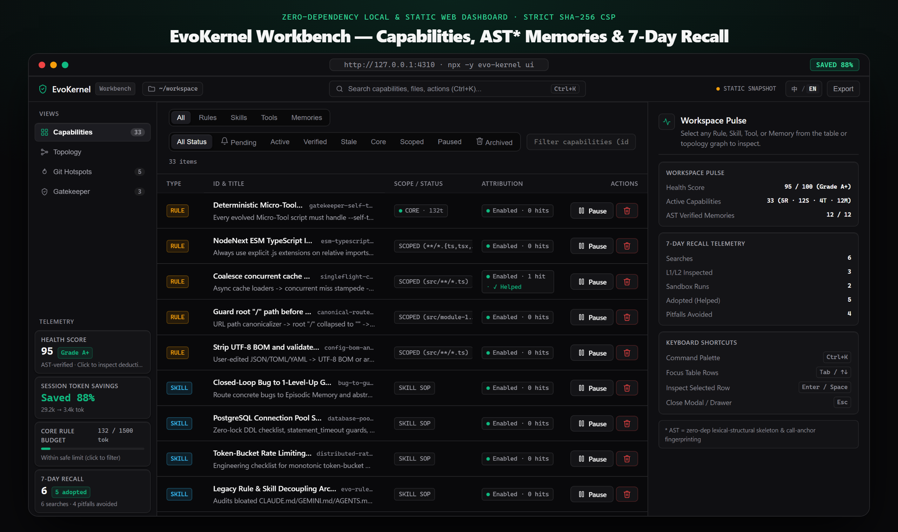

<div align="center">

# 🧬 EvoKernel (evo-kernel)

### 告诉 AI 一次，它就一直记得你。

**你的习惯、偏好和工作要求，在 Claude Code、Codex、Cursor、Gemini 等工具和每个项目里自动生效。**  
*全部存在你自己的电脑上——随时查看、撤销或一键清除。*

[](https://github.com/damonless/EvoKernel/actions/workflows/ci.yml)
[](https://damonless.github.io/EvoKernel/demo/)
[](https://www.npmjs.com/package/evo-kernel)
[](LICENSE)

**[English](README.md) · [简体中文](README.zh-CN.md) · [🌐 产品主页](https://damonless.github.io/EvoKernel/) · [🖥️ 在线交互式工作台 (EvoKernel Workbench)](https://damonless.github.io/EvoKernel/demo/) · [📊 基准评测 (Benchmarks)](benchmarks/README.md)**

<br/>

<a href="https://damonless.github.io/EvoKernel/"></a>

</div>

> **EvoKernel 是什么？** EvoKernel 为你的桌面与编码 AI 工具提供一套**完全在本地运行的长期记忆系统**——一边记住你的跨项目个人习惯与工作流，一边沉淀团队经过代码校验的项目避坑经验；0 外部依赖、支持 1 秒原子撤销，并通过精简的 5 工具固定 MCP 网关接入主流 AI 工具。

---

## ⚡ 30 秒极速上手

> **环境要求：Node.js >= 22.5.0**（基于原生 `node:sqlite`，0 外部 npm 依赖）。  
> 当前是 Node 18 / 20？免全局升级可直接试用：`npx -y -p node@22 evo-kernel score`

只需 3 步，让你的 AI 工具记住第一条个人习惯：

```bash
# 1. 一次接入你的桌面 AI 工具（全局生效）
npx -y evo-kernel init --global

# 2. 直接保存你的第一条习惯（也可以直接在对话中告诉 AI：“记住：以后回复先给 diff”）
npx -y evo-kernel profile add "回复先给 diff 和根因，不要写客套废话"

# 3. 打开 EvoKernel Workbench 可视化查看和编辑（或运行 `npx -y evo-kernel doctor` 检查接入状态）
npx -y evo-kernel ui
```

**三种初始化模式怎么选：**
- `npx -y evo-kernel init --global` — 记住**你的个人习惯与工作流**，自动同步到 Claude Code、Codex、Cursor、Gemini、Windsurf、Cline、Roo 和 OpenCode。
- `npx -y evo-kernel init` — 给**当前项目仓库**启用规则护栏与代码校验避坑记忆（加 `--stealth` 可保持 Git 工作区零改动）。
- `npx -y evo-kernel init --all` — 一次同时初始化**当前仓库 + 全局个人画像**（随时可加 `--dry-run` 先预览）。

### 👀 随时查看 / 撤销 / 忘掉它记住的内容

EvoKernel 记住的一切都保存在你自己的电脑上，随时可查、可撤、可删：

- **查看它记住了什么**：`npx -y evo-kernel profile show`（查看当前生效的常驻习惯与按需工作流）
- **1 秒撤销刚才的改动**：`npx -y evo-kernel profile undo` —— 或直接在对话中说“撤销刚才的改动”（支持个人习惯、项目规则/经验以及合并操作整批回滚）
- **忘掉某条习惯**：`npx -y evo-kernel profile remove <id>`（需要完整卸载或清理数据时，见下方[可逆性与卸载](#-可逆性与团队协作及隐私安全保障)）

<details>
<summary><b>🖥️ 可视化界面导览：3 步终端流水线、EvoKernel Workbench 工作台与 X-Ray 诊断卡 (点击展开)</b></summary>

<br/>

<div align="center">
  
</div>

<br/>

<table>
<tr>
<td align="center" width="56%">
  <b>EvoKernel Workbench (<code>npx evo-kernel ui</code>)</b><br/>
  <a href="https://damonless.github.io/EvoKernel/demo/"></a>
</td>
<td align="center" width="44%">
  <b>终端矢量 X-Ray 诊断卡 (<code>npx evo-kernel score</code>)</b><br/>
  
</td>
</tr>
</table>

</details>

<details>
<summary><b>🛠️ 源码克隆构建、CI 交付物核检与高级 CLI 流程 (点击展开)</b></summary>

```bash
# 从源码克隆并编译（编译耗时 <50ms，无需任何 npm install）
git clone https://github.com/damonless/EvoKernel.git
cd EvoKernel
node ./scripts/build.mjs

# 一次初始化仓库与全局个人画像（可先用 --dry-run 预览）
node ./dist/cli/index.js init --all --dry-run
node ./dist/cli/index.js init --targets auto --stealth

# 冷启动挖掘当前仓库架构、技术栈规约与 Git 历史 Bug 修复经验
node ./dist/cli/index.js bootstrap --max-commits=50

# 管理个人习惯与工作流
node ./dist/cli/index.js profile list
node ./dist/cli/index.js profile show
node ./dist/cli/index.js profile add "以后回复不要用表格，直接用大白话"
node ./dist/cli/index.js profile onboard --preset concise-ceo --apply
node ./dist/cli/index.js profile sync --dry-run
node ./dist/cli/index.js profile undo
node ./dist/cli/index.js profile path

# CI / 工程交付物规范核检（支持 .xlsx, .docx, .pptx, .csv, .json, .md）
npx -y evo-kernel check ./README.md

# 检查能力树结构、代码链接新鲜度与 MCP 连接体检
node ./dist/cli/index.js tree
node ./dist/cli/index.js memory verify
node ./dist/cli/index.js doctor --roi
node ./dist/cli/index.js audit --global
```

</details>

---

## 🔒 可逆性与团队协作及隐私安全保障

EvoKernel 从设计之初就坚持极低试错门槛、完全透明可审查与随时 100% 干净回退：

### 1. `evo init` 动了哪些文件与一键无损卸载还原
执行 `npx evo-kernel init` 时，仅精准修改以下三处隔离边界：
- **宿主 Agent 规则文件**：在检测到的宿主规则文件（`CLAUDE.md`、`AGENTS.md`、`.cursor/rules/evo-kernel.mdc`，或在存在 `.gemini/` 目录时注入 `GEMINI.md`）中插入紧凑（< 1,100 tokens）且由 `<!-- EVO:START -->` 与 `<!-- EVO:END -->` 严格包裹的受控块。标记块之外的原有规则内容绝不触碰。
- **宿主 MCP 配置文件**：仅为宿主注册唯一的 `evo-kernel` stdio 元网关服务项（未执行虚拟化时绝不修改已有第三方 MCP 配置）。
- **项目本地 `.evo/` 资产目录**：初始化局部能力树与情景记忆结构（`.evo/rules/`, `.evo/skills/`, `.evo/memories/`, `.evo/tools/`, `.evo/.cache/`）。

若需将项目与宿主配置还原至接入前的初始状态，运行：
```bash
npx -y evo-kernel uninstall --dry-run   # 预览将还原的 MCP 与剥离的标记，不写入文件
npx -y evo-kernel uninstall             # 还原虚拟化 MCP、剥离标记/Hook/MCP（默认保留 .evo/ 数据安全）
# 永久删除数据（交互终端需二次输入确认；非交互脚本必须显式传 --yes）：
npx -y evo-kernel uninstall --global --purge
```
`evo uninstall` 会自动还原已虚拟化的第三方 MCP 配置、剥离所有 `<!-- EVO:START -->` 注入块、清理注册的生命周期 Hook 与 `evo-kernel` MCP 注册项，并**默认保留你的 `.evo/` 用户数据安全**；仅当显式传入 `--purge` 时才会删除 `.evo/`（`--dry-run` 可预览全部变更；非交互模式下缺少 `--yes` 将安全中止）。

### 2. 多人团队协作共享 vs. `--stealth` 个人无痕试用模式
- **多人团队协作共享（默认 `evo init`）**：将 `.evo/rules/`、`.evo/memories/` 与 `.evo/tools/` 提交至 Git 远端仓库。团队中所有成员及其编码智能体均可实时复用沉淀的根因排障记忆与受控沙盒微工具；内部临时缓存（`.evo/.cache/`）已自动加入忽略规则。
- **个人独立试用他人/开源仓库（`evo init --stealth`）**：自动将 `.evo/` 及修改的宿主配置文件写入本地 `.git/info/exclude`，完全不修改项目 `.gitignore`，更不会产生任何未提交的 Git 工作区脏变更。实现**零 Git 污染、零提交干扰**。

### 3. 100% 本地优先与零外发遥测
EvoKernel **不包含任何网络外发请求**，不收集任何用户使用数据，也无需联网调用任何外部云端 API。所有 SQLite FTS5 索引与可观测召回账本（`.evo/.cache/telemetry.db`）100% 保存在本地开发者机器中。

---

## 🧭 深入了解：双核架构、能力边界与基准数据

<details>
<summary><b>🧭 精简双核架构与能力边界（做什么 / 不做什么）（点击展开）</b></summary>

<br/>

EvoKernel 作为**面向兼容 MCP 的 AI 智能体的精简双核本地优先上下文与记忆内核**运行：

1. **第一层（Layer 1）— 仓库级确定性工程记忆（Repo-Scoped, `.evo/`，覆盖 10 大项目宿主含 Copilot）**：
   - 跨 Git 分支的代码校验情景记忆（`[VERIFIED]` / `[OTHER_BRANCH]` / `[STALE]`）、严格收敛的 **1,500-Token** 核心不变式预算、按路径匹配的领域防护规则（`scope_glob`）、静默后台召回（不刷屏对话正文）与通过 `--self-test` 验证的沙盒微工具，覆盖 **10 大项目记忆宿主**（Claude Code、Cursor、Codex、Windsurf、Cline、Roo Code、GitHub Copilot、OpenCode、Gemini CLI 与 Antigravity）。
2. **第二层（Layer 2）— 跨工作区用户认知体系（3 层离线召回，覆盖 8 大个人画像同步宿主）**：
   1. **Tier 1 — 常驻个人画像卡片（`800`-Token 全渲染预算）**：将显式个人习惯（`style | formatting | communication | workflow | requirement | knowledge`）通过 `<!-- EVO:PROFILE:START -->...<!-- EVO:PROFILE:END -->` 自动推送到 **8 大桌面 AI 宿主**（不含 GitHub Copilot，因 Copilot 无全局个人规则文件目标）：Claude Code（`~/.claude/CLAUDE.md`）、Gemini / Antigravity（`~/.gemini/GEMINI.md`）、Codex（`~/.codex/AGENTS.md`）、Windsurf（`~/.codeium/windsurf/memories/global_rules.md`）、Cursor（`~/.cursor/rules/evo-user-profile.mdc`）、Cline（`~/.cline/rules/evo-user-profile.md`）、Roo（`~/.roo/rules/evo-user-profile.md`）与 OpenCode（`~/.config/opencode/AGENTS.md`）。
   2. **Tier 2 — 动态任务与工作流目录菜单（`250`-Token 上限）**：将 `always_on: false` 的按需偏好与带 `trigger_cue` 的非种子全局技能随画像卡片同步推送，使 AI 智能体无需猜测关键词即可语义化调用 `evo_inspect(id, "L2")` 加载高频工作流与工作要求。
   3. **Tier 3 — 全局非代码个人经验记忆（`memory_type: "personal"`）**：跨工作区个人经验沉淀，无需绑定代码符号（标记为 `[PERSONAL]`），配合扩充的双语办公/写作/工作流词库在 0 启动 Token 开销下实现精准召回。
   - **即时生效 + 原子撤销**：显式偏好与个人经验提交后立即生效（`approved`）并返回通俗中文/英文回执（`human_receipt`），同时写入只追加账本 `profile-history.jsonl`，支持通过 `evo profile undo`、对话内 `evo_propose(undo: true)` 或 Workbench **个人画像**视图整批回滚。

### 🧱 能力边界：做什么 / 明确不做什么

| 边界类别 | 具体说明 |
| :--- | :--- |
| **✅ 做什么（In Scope）** | • **Layer 1 仓库代码校验记忆（10 大项目宿主含 Copilot）**：跨 Git 分支追踪符号级排障记忆、1,500-Token 核心不变式与领域规则。<br/>• **5 工具固定元 MCP 网关**：`evo_search`、`evo_inspect`、`evo_run`、`evo_propose`、`evo_compact` —— 全量支持可选 `workspace` 参数适配空白/非代码对话（0 外部依赖、100% 本地优先、提示词前缀稳定不击穿缓存）。<br/>• **Layer 2 三层离线用户认知体系（8 大个人画像同步宿主）**：800-Token 画像卡推送至 8 大桌面 AI 宿主、250-Token 动态任务目录菜单、Tier 3 `memory_type: "personal"` 经验沉淀、Markdown 导入与引导预设，以及即时生效 + 原子撤销。<br/>• **确定性微工具与规范核检**：`--self-test` 沙盒微工具、交付物规范核检（`evo check`）与规则膨胀审计（`evo audit`、`evo refactor`）。 |
| **🚫 明确不做什么（Out of Scope）** | • **不是消费级跨应用“第二大脑”**：不接入网页版聊天窗口（ChatGPT / Claude Web）、手机 App 或缺乏本地 MCP 与规则文件钩子的即时通讯软件。<br/>• **不是后台云端 LLM 读心器**：不会在后台调用云端模型默默猜测或外传未显式表达的隐含习惯。<br/>• **不会在后台自动改写你的代码**：EvoKernel 只负责记录和召回规则、习惯与经验，绝不会在后台擅自修改你的源码。 |

</details>

<details>
<summary><b>📈 50 轮每次对话固定开销推演模型与本地引擎微基准 (<code>npm run benchmark</code>)（点击展开）</b></summary>

<br/>

基于典型全栈工程挂载 **8 个常见 MCP 服务**（`github`, `playwright`, `kubernetes`, `docker`, `linear`, `postgres`, `sentry`, `context7` —— 共计 **77 个工具**）+ 成熟仓库知识库（10 条规则、4 个技能、5 个微工具、15 条排障记忆），在 **50 轮连续对话 + 3 次中途规则/工具演进**下的上下文开销推演模型与本地引擎微基准（本地执行 `npm run benchmark` 即可复现）。
*零前缀失效前提说明*：0 次中途缓存击穿建立在新演进资产以默认的 `core: false` 领域规则（Scoped Rules）、技能、微工具或排障记忆（`memory`）形态沉淀至 `.evo/` 的前提之上——此类演进不修改顶层 `tools/list` Schema 与宿主 `CLAUDE.md` 常驻 L0 前缀。

| 核心指标 | 传统直连多 MCP + 巨石 `CLAUDE.md` | **🧬 EvoKernel 5-Tool 虚拟网关** | 模型推算（8 个常见 MCP / 77 个工具） |
| :--- | :---: | :---: | :---: |
| **暴露给模型的工具 Schema** | 77 个工具定义 (`14,700` tok) | **5 个固定元工具原语 (`2,047` tok)** | **-93.5% Schema 数量 (`-86.1%` 体积)** |
| **每次对话固定开销 / 轮** | 27,150 tokens | **3,197 tokens** | **-88.2% 模型推算每次对话固定开销** |
| **中途演进引发的缓存击穿** | 3 次全量前缀重算 | **0 次（100% 命中缓存）** | **100% 提示词缓存稳定** |
| **50 轮累计输入 Tokens** | 1,931,250 tokens | **745,120 tokens** | **-61.4% 累计负载** |
| **50 轮账单成本 (Claude Sonnet 4.5)** | \$1.15 | **\$0.34** | **节省 70.2% API 成本** |
| **50 轮账单成本 (Claude Opus 4.5)** | \$5.76 | **\$1.72** | **节省 70.2% API 成本** |
| **本地引擎 AST 校验速率** | 无校验（重构后静默腐败） | **~11.4 ms / 条记忆** | **~500 ms 批量校验 44 条记忆¹** |

> ¹ *术语说明：* 代码链接防漂移采用**零依赖词法-结构骨架指纹（Zero-Dep Lexical-Structural Skeleton Fingerprinting）**，无需外部重型编译器即可对注释修改、代码格式化和行号漂移天然免疫。

</details>

<details>
<summary><b>⚡ 为什么大多数“自我进化规则/技能”方案在 30 次对话后必然崩溃？与 6 道沙盒门禁（点击展开）</b></summary>

<br/>

在使用 Claude Code、Cursor、Windsurf、Cline、Roo、Copilot、Codex、OpenCode、Gemini 或 Antigravity 时，开发者普遍遭遇五大工程陷阱：

1. **规则膨胀与上下文腐败（Context Rot）**：每次踩坑就往 `CLAUDE.md` 或 `.cursorrules` 追加一条 `Never do X`，很快就会演变为上万 Token、前后冲突的“规则垃圾堆”。一旦常驻规则超过 ~1,500 Tokens，大模型的 `Lost-in-the-Middle` 效应会令旧规则大面积失效。
2. **“自评自改”的幻觉固着（Worker Grading Its Own Homework）**：让同一个上下文中的 LLM 不经确定性沙盒自测直接修改全局脚本或技能，极易把包含语法错误、硬编码个人绝对路径（如 `C:\Users\Alice\...`）的损坏脚本永久固化为“持久工具”。
3. **动态 MCP 引发的 Prompt Cache 雪崩**：如果“动态进化 MCP”意味着不断向 IDE 注册新的一级 MCP 工具并触发 `list_changed`，每次工具模式改变都会**直接击穿 Claude / DeepSeek 的前缀缓存（Prompt Caching）**，导致 Token 成本暴涨 5~10 倍并伴随卡顿与重启。
4. **第三方 MCP 蔓延灾难（MCP Sprawl）**：如果直接在宿主配置中接入 10 个下游业务 MCP 服务器（Postgres、GitHub、Docker 等），宿主 System Prompt 每次都需要携带 50~100 个庞大的 JSON Schema，急剧挤占有效注意力并显著增加模型误调概率。
5. **混杂因果归因与盲目进化（Confounded Causation）**：智能体在多变量复杂排障或多次尝试后，往往盲目把成功归因于某条不相干的规则，导致误报、偏见与迷信规则在经验库中交叉污染。

**EvoKernel 用一套“确定性沙盒门禁 + 代码锚定记忆 + 跨工作区画像推送 + 固定元路由网关 + 下游 MCP 虚拟化代理”彻底解决上述问题：**

<div align="center">
  
</div>

</details>

---

## 📊 行业同类项目全景对比矩阵

<details>
<summary><b>📊 展开 13 维同类方案全景对比矩阵（MemGPT / Letta、Aider、直通 MCP 代理、ECC、SkillClaw vs. EvoKernel）</b></summary>

<br/>

| 对比维度 | `MemGPT / Letta` | `Aider` | 传统 MCP 代理 (直通型) | `affaan-m/ECC` | `AMAP-ML/SkillClaw` | **🧬 EvoKernel v0.5.0 (本项目)** |
| :--- | :--- | :--- | :--- | :--- | :--- | :--- |
| **核心定位** | 有状态对话 Agent 记忆数据库 | Git 驱动的终端结对编程工具 | 聚合多个 MCP 端口的直通桥梁 | 静态工程提示词与规则合集 | 后台 LLM 演化学习 Agent | **面向 AI 编程智能体的确定性自演进元内核** |
| **接入形态** | 依赖外部服务 / Postgres / 独立进程 | 独立 Python CLI 替代主流 IDE | 暴露所有子工具到 host tools/list | 静态预置 Markdown 模板 | 劫持 `/v1/chat` 本地反向代理 | **直接接入现有工具的单一 Meta-MCP + < 1,100 tokens 种子 (`≈1,050 tokens`)** |
| **运行依赖** | 笨重依赖（Postgres、Python、向量库） | Python pip 工具链 | Node / Python 复杂依赖 | 零依赖（纯 Markdown 文本） | Python FastAPI 守护进程 | **0 依赖（纯 Node.js `>= 22.5` 原生特性：`node:sqlite`, `node:module`, `node:test`）** |
| **Prompt Cache 稳定性** | 频繁刷新全量上下文，缓存命中极低 | 随代码编辑频繁波动 | **破坏性**（暴露所有子工具，任何增删均导致前缀击穿） | 初始静态前缀偏大 | 中立 | **100% 字节级稳定：对宿主仅暴露恒定 5 个元工具原语** |
| **下游 MCP 虚拟化** | 无 | 无 | 直通暴露（50+ 工具全量倾倒至提示词） | 无 | 无 | **零缓存击穿的 FTS5 索引 + 按需 stdio JSON-RPC 动态转发代理** |
| **验证门禁机制** | 模型自评 | Git commit diff 与本地测试 | 无 | 手动人工 `/learn-eval` | 异步 LLM 评审 | **6 道确定性沙盒门禁（静态安全审查、词法去符号化、沙盒 Exit 0、BM25 去重、1500-Token 阈值、防因果混淆）** |
| **跨工作区个人偏好推送** | 对话人设记忆（云端/数据库） | 无 | 无 | 无 | 云端偏好存储 | **3 层离线用户认知：800-Token 画像卡 + 250-Token 任务目录菜单推送至 8 大宿主 + Tier 3 `memory_type: "personal"` + `evo profile undo`** |
| **交付物规范消费检查** | 无 | 无 | 无 | 无 | 无 | **内置零依赖通用规范核检器（覆盖 `.xlsx`, `.docx`, `.pptx`, CSV, JSON/JSONL, Markdown）** |
| **情景记忆与防漂移** | 语义向量近似检索（重构后易幻觉） | 依赖符号跳转图谱 | 无 | 无（纯静态指南） | 无 AST 验证 | **零依赖词法/结构符号指纹（快速 AST 哈希、自动 `[STALE]` 降级、Stage-3 拓扑穿透锚点）** |
| **工作台与诊断体检** | 独立 Web + Postgres 服务 | 无 | 无 | 无 | Web 界面 | **`evo score`（<25ms 零写入体检卡）与 `evo ui`（0 依赖 EvoKernel Workbench 工业级工作台、双模态原生微窗口、SSE 实时同步、严格 CSP、单文件导出）** |
| **因果遥测与成效归因** | 无 | Git 变更行数 | 无 | 无 | 胜率计数器 | **细粒度成效记账本（`helped` / `hurt` / `contested`）与 `ERR_CONFOUNDED_CAUSATION` 防混淆** |
| **多 Agent 宿主矩阵支持** | 仅独立模式 | 仅独立模式 | 通用 MCP 客户端 | 仅限 Claude Code / Cursor | 通用反代 | **原生支持 10 款主流编码环境（Claude, Cursor, Windsurf, Cline, Roo, Copilot, Codex, OpenCode, Gemini, Antigravity）** |
| **冷启动仓库经验挖掘** | 初始为空，依赖会话积累 | Git 仓库扫描 | 初始为空 | 静态合集 | 初始为空 | **`evo bootstrap`：10 秒内自动挖掘项目多栈经验与 Git 历史 Bug 修复沉淀** |

</details>

---

<a id="-零依赖原生架构"></a>
<a id="-核心架构5-个固定元工具原语"></a>
## 🧠 核心架构与深度子系统手册

EvoKernel 在 `stdio` 上仅暴露 **5 个不可变元工具原语**（`evo_search`、`evo_inspect`、`evo_run`、`evo_propose`、`evo_compact` —— 全量支持可选 `workspace` 参数适配空白/非代码对话）以确保 100% KV 缓存命中，底层配套 3 层离线用户认知体系（`evo profile` + `evo init --global`）、零依赖交付物规范消费核检器、确定性因果归因与 10 大宿主无损适配器。

<details>
<summary><b>🧠 5 个固定元工具原语、下游 MCP 代理虚拟化与生命周期 Hook 路由（点击展开）</b></summary>

<br/>

### 5 个不可变元工具原语（`stdio` JSON-RPC 2.0）

| 元工具名称 | 层级 | 功能职责 |
| :--- | :--- | :--- |
| `evo_search` | **L0** | FTS5 BM25 检索规则、技能、微工具、虚拟化外部工具、情景记忆与个人偏好（支持可选 `workspace` 与 `scope: "global"`）。执行实时 Stage-2 AST 校验，自动将失效记忆降级为 `[STALE]` 并标记 `[PERSONAL]` 经验。 |
| `evo_inspect` | **L1 / L2** | 渐进披露加载器。提供故障症状/根因/方案三元组、虚拟化工具的完整 JSON Schema 以及 **Stage-3 拓扑穿透锚点**（真实代码行号、调用链与负面死胡同）。 |
| `evo_run` | **执行** | 在本地沙盒中执行微工具（`.mjs`, `.py`, `.ps1`, `.sh`）或通过 `McpProxyManager` 动态代理调用下游 MCP 服务。 |
| `evo_propose` | **演化** | 提交候选规则、技能、微工具、情景记忆（`code` 或 `personal`）或个人偏好，通过 6 道确定性沙盒门禁（静态安全审查、词法去符号化、沙盒 Dry-Run 自测、BM25 与极性冲突去重、Token 预算硬顶、因果混淆防护）。显式偏好与个人经验即时生效并写入 `profile-history.jsonl` 支持撤销。 |
| `evo_compact` | **GC** | 原子级合并零碎规则，或将已失效的 `[STALE]` 记忆归档至 `.evo/archive/`，确保核心 Token 占用严格收敛在 1,500 Token 红线内。 |

### 下游 MCP 代理虚拟化网关（`evo virtualize`）

```text
Host Coding Agent (Claude / Cursor / Copilot / etc.)
                  │
                  ▼ Fixed 5-Tool stdio Interface (100% Byte-Stable KV Cache)
         ╔════════════════════════════════════════════════════╗
         ║               EvoKernel Meta-MCP                   ║
         ║  evo_search · evo_inspect · evo_run · propose · compact
         ╚════════════════════════════════════════════════════╝
                  │                      │
        FTS5 BM25 Search          Proxy Execution (`evo_run`)
                  ▼                      ▼
        ┌────────────────────┐   ┌─────────────────────────────┐
        │ capability_fts     │   │ McpProxyManager (Pool)      │
        │ ext__postgres__... │   └──────────────┬──────────────┘
        │ ext__github__...   │                  │ stdio JSON-RPC
        └────────────────────┘                  ▼
                                 ┌─────────────────────────────┐
                                 │ Downstream MCP Servers      │
                                 │ postgres · github · docker  │
                                 └─────────────────────────────┘
```

```bash
evo virtualize --dry-run   # 演练预览：查看折叠下游 MCP 后可节省的 Token 数量
evo virtualize             # 一键将第三方 stdio MCP 服务折叠接入 EvoKernel 动态代理池
evo virtualize --restore   # 无损还原：随时将虚拟化的 MCP 配置写回原宿主配置文件
```

### 通用生命周期 Hook 路由（`evo hook <pre-tool | post-tool | stop | pre-commit>`）

```bash
evo hook pre-tool --tool Bash --command "..."               # 工具执行前安全校验与作用域规则检查
evo hook post-tool --tool Edit --file src/core/storage.ts   # 监控文件修改、只读排障诊断 (>=10 次读取) 并召回局部规则
evo hook stop                                               # 会话结束提示沉淀经验并触发反污染脏文件告警
evo hook pre-commit                                         # 在 git commit 前拦截内部缓存与超出 1500-Token 的超额规约
evo hook mark-recovery                                      # 在命令执行报错后记录错误自愈遥测指标
```

</details>

<details>
<summary><b>👤 3 层离线用户认知体系 (<code>evo profile</code>)、1 秒撤销与确定性因果归因（点击展开）</b></summary>

<br/>

```bash
# 一次全局安装（“安装一次，全局认识你”）并管理 ~/.evo/global/.evo/
evo init --global            # 初始化 ~/.evo/global、挂载全局 MCP、刷新插件 L0 种子并同步画像
evo uninstall --global       # 剥离全局宿主规则中的 EVO:PROFILE 标记块

# 完整用户全局偏好与工作流 CLI
evo profile list             # 列出全部个人偏好及 800-Token 卡片 / 250-Token 菜单预算占用
evo profile show             # 查看编译后的个人画像卡片与动态任务目录菜单
evo profile add --category workflow --title "..." --summary "..." --content "..."
evo profile remove <id>      # 归档指定偏好、追加撤销快照并重新同步宿主
evo profile undo [id]        # 基于只追加 profile-history.jsonl 实现 1 秒撤销并同步宿主
evo profile import notes.md [--apply]             # 解析 Markdown 习惯并通过 Gatekeeper 提交
evo profile onboard [--preset concise-ceo --apply] # 应用引导预设或运行 3 步交互式访谈
evo profile sync [--dry-run] # 将 <!-- EVO:PROFILE:START -->...<!-- EVO:PROFILE:END --> 推送至 8 大桌面宿主
evo profile clean            # 清理宿主全局规则中的 EVO:PROFILE 标记块
evo profile path             # 打印全局根目录、preferences 目录与 profile-digest.md 路径
```

可在任意支持 MCP 的智能体中（即便在无仓库的空白/非代码对话中，省略 `workspace` 参数即可）直接通过 `evo_propose` 沉淀跨工作区习惯或个人经验：

```json
{
  "tool": "evo_propose",
  "arguments": {
    "kind": "preference",
    "scope": "global",
    "category": "style",
    "always_on": true,
    "id": "concise-diff-first-replies",
    "title": "Concise Diff-First Engineering Replies",
    "l0_summary": "Lead with root cause and minimal unified diffs; skip boilerplate recaps.",
    "content": "- Start with the concrete diagnosis or patch.\n- Avoid filler acknowledgments and redundant summaries."
  }
}
```

- **Tier 1 — 常驻个人画像卡片（`800`-Token 全渲染预算）**：`always_on: true` 的偏好（`style | formatting | communication | workflow | requirement | knowledge`）会编译为 `profile-digest.md`（与仓库 1,500-Token 核心不变式彻底隔离），并通过 `<!-- EVO:PROFILE:START -->...<!-- EVO:PROFILE:END -->` 标记精准推送至 **8 大桌面 AI 宿主**：`~/.claude/CLAUDE.md`、`~/.gemini/GEMINI.md`、`~/.codex/AGENTS.md`、`~/.codeium/windsurf/memories/global_rules.md`（内置 6,000 字符安全截断）、`~/.cursor/rules/evo-user-profile.mdc`、`~/.cline/rules/evo-user-profile.md`、`~/.roo/rules/evo-user-profile.md` 与 `~/.config/opencode/AGENTS.md`。
- **Tier 2 — 动态任务与工作流目录菜单（`250`-Token 上限）**：将偏好设为 `always_on: false` 并填写 `trigger_cue`（连同非种子全局技能），即可在画像卡片旁生成按需目录菜单，智能体在匹配任务开始前即可语义化调用 `evo_inspect(id, "L2")` 加载完整工作流。
- **Tier 3 — 全局非代码个人经验记忆（`memory_type: "personal"`）**：支持存储跨工作区非代码经验教训（`scope: "global"`，无需代码 AST 符号绑定，标记 `[PERSONAL]`），配合扩充的双语办公/写作/工作流词库通过 `evo_search(query, scope: "global")` 召回。
- **即时生效与 1 秒撤销**：显式偏好与个人经验提交后立即生效（`approved`）并输出可见回执，同时写入只追加账本 `profile-history.jsonl`，支持通过 `evo profile undo` 或 Workbench **Personal Profile Studio** 一键回滚。
- **防因果混淆门禁 (`ERR_CONFOUNDED_CAUSATION`)**：在 SQLite 中细粒度记录 `helped`、`hurt`、`contested` 成效账本；当单次排障周期内多条能力同时命中时自动阻断单一变量抢功，要求提供 Stage-3 **拓扑穿透锚点**证明真实因果。

</details>

<details>
<summary><b>📑 零依赖交付物规范消费核检器 (<code>evo check</code> / <code>deliverable-canonical-inspector</code>)（点击展开）</b></summary>

<br/>

内置开箱即用的零依赖规范消费检验器，拦截表面正常但在下游工具中解析崩溃的交付物缺陷：

```bash
npx evo-kernel check report.xlsx          # 终端直观核检报告
npx evo-kernel check report.xlsx --json   # 面向 CI 流水线的结构化 JSON 输出
```

- **XLSX (`.xlsx`)**：纯原生 IEEE 802.3 CRC32 + ZIP Central Directory 解压引擎；正规化开首斜杠路径、剔除 `<rPh>` 拼音注音、保留 `<c .../>` 自闭合节点后的兄弟单元格，并精准拦截 `#REF!`、`#DIV/0!`、`#VALUE!`、`t="e"` 公式错误与空工作表。
- **DOCX (`.docx`) 与 PPTX (`.pptx`)**：规范提取层级标题、段落、表格矩阵与按自然序排列的 `## Slide N` 结构，拦截 `EMPTY_DOCUMENT` 与 `EMPTY_PRESENTATION`。
- **CSV、JSON/JSONL 与 Markdown (`.md`)**：RFC-4180 CSV 解析（拦截 `RAGGED_COLUMNS`）、逐行 `requiredKeys`/`strictKeys` 校验、`UNCLOSED_CODE_FENCE` 未闭合代码块检测以及代码围栏外的 `{{VARIABLE}}` 模板占位符泄漏拦截。

</details>

<details>
<summary><b>🎯 10 款主流智能体宿主适配矩阵与静默失败防御（点击展开）</b></summary>

<br/>

| 智能体 / 宿主 | 规则注入目标 | MCP 网关挂载目标 | 自动识别特征 | 隐身模式 (`.git/info/exclude`) |
| :--- | :--- | :--- | :--- | :---: |
| **Claude Code** | `CLAUDE.md` | `.mcp.json` + `.claude/settings.json` | `CLAUDE.md`, `.claude/`, `CLAUDE_CONFIG_DIR`, `~/.claude` | ✅ |
| **Cursor** | `.cursor/rules/evo-kernel.mdc` | `.cursor/mcp.json` | `.cursor/`, `.cursorrules`, `CURSOR_AGENT`, `~/.cursor` | ✅ |
| **Windsurf** | `.windsurfrules` | `.windsurf/mcp.json` | `.windsurf/`, `.windsurfrules`, `WINDSURF_DIR`, `~/.windsurf` | ✅ |
| **Cline** | `.clinerules` | `.cline/mcp.json` | `.clinerules`, `.cline/`, `CLINE_DIR`, `~/.cline` | ✅ |
| **Roo Code** | `.roo/rules/evo-kernel.md` | `.roo/mcp.json` | `.roo/`, `.roorules`, `ROO_DIR`, `~/.roo` | ✅ |
| **GitHub Copilot / VS Code** | `.github/copilot-instructions.md` | `.vscode/mcp.json` | `.github/copilot-instructions.md`, `.vscode/`, `VSCODE_PID` | ✅ |
| **Codex CLI** | `AGENTS.md` | `.codex/config.toml` | `.codex/`, `CODEX_HOME`, `~/.codex` | ✅ |
| **OpenCode** | `opencode.json` + `AGENTS.md` | `opencode.json` | `opencode.json`, `.opencode/`, `OPENCODE_CONFIG` | ✅ |
| **Gemini CLI** | `GEMINI.md` *（当 `AGENTS.md` 共存时自动跳过）* | `.gemini/settings.json` | `GEMINI.md`, `.gemini/`, `GEMINI_CLI_HOME`, `~/.gemini` | ✅ |
| **Antigravity** | `AGENTS.md` | `mcp_config.json` *（全局：`~/.gemini/antigravity/mcp_config.json`）* | `mcp_config.json`, `ANTIGRAVITY_AGENT`, `~/.gemini/antigravity` | ✅ |

- **静默失败表面防御**：UTF-8 BOM（`0xFEFF`）自动剥离、保留注释的无损 TOML/JSON 合并、`scripts/boot-mcp.mjs` 原生 TypeScript 平滑降级、自动修复工作区与全局宿主配置中陈旧的 `_npx` 缓存路径、以及 50ms 非阻塞 Stdin 超时防护。

</details>

<details>
<summary><b>🌳 查看 ASCII 自演进能力树 (.evo/) 结构展示（点击展开）</b></summary>

```text
╭──────────────────────────────────────────────────────────────────────────╮
│ 🧬 EvoKernel — Self-Evolving Capability Tree (.evo/)                     │
╰──────────────────────────────────────────────────────────────────────────╯
📦 Workspace: /path/to/your-repo
├── 🛡️  Rules (5 active | Core Token Budget: 132/1500 tokens)
│   ├── [CORE] gatekeeper-self-test-invariant (132 tok | hits: 4) — Every evolved Micro-Tool script must handle --self-test and exit 0.
│   ├── [SCOPED] esm-typescript-imports (154 tok | hits: 7) — Always use explicit .js extensions on relative imports in ESM TypeScript.
│   ├── [SCOPED] core-architecture-and-ast-invariants-guard (728 tok) — Dry-run compaction, comment-stripped AST matching & Git lookups.
│   ├── [SCOPED] multi-harness-config-and-proxy-isolation (906 tok) — Lossless config merge/restore, fail-closed user configs & proxy roots.
│   └── [SCOPED] workspace-isolation-and-fts5-guard (537 tok) — Isolate uninitialized fallback, parent Git detection & FTS5 search.
├── ⚡ Skills (2 verified L0/L1/L2 playbooks)
│   ├── [SOP] bug-to-guardrail-sop (hits: 3 | tags: debugging,evolution) — Standard workflow to turn a resolved root cause into a Rule.
│   └── [SOP] evo-rule-architect (hits: 2 | tags: refactor,rules) — Rule decoupling and token budget refactoring workflow.
├── 🔧 Micro-Tools (4 sandboxed scripts | Fixed Meta-MCP Routed)
│   ├── [NODE] agy-config-auditor (runs: 55 | pass: 100%) — Audits host rule budgets and memory AST symbols.
│   ├── [NODE] deliverable-canonical-inspector (runs: 18 | pass: 100%) — Zero-dep validator for .xlsx, .docx, .pptx, CSV, JSON, MD.
│   ├── [NODE] git-hotspot-analyzer (runs: 5 | pass: 100%) — Identifies top 10 frequently modified files in recent git history.
│   └── [NODE] workspace-metrics-scanner (runs: 13 | pass: 100%) — Scans file counts, LOC, and extension distribution.
└── 🧠 Episodic Memories (41 fault cases | 41 VERIFIED · 0 STALE)
    ├── [VERIFIED] audit-broken-refs-and-hook-param-fix (confidence: HIGH | symbols: 2/2 fresh)
    ├── [VERIFIED] cli-help-zero-side-effect-isolation (confidence: HIGH | symbols: 2/2 fresh)
    ├── [VERIFIED] codex-hooks-corrupt-file-unlink (confidence: HIGH | symbols: 2/2 fresh)
    ├── [VERIFIED] generic-angle-semicolon-multiline-drift (confidence: HIGH | symbols: 2/2 fresh)
    ├── [VERIFIED] ghost-workspace-resurrection-and-sqlite-handle-lock (confidence: HIGH | symbols: 5/5 fresh)
    ├── [VERIFIED] harness-hook-filter-preserve-untouched-entries (confidence: HIGH | symbols: 3/3 fresh)
    ├── [VERIFIED] issue-25-lexical-ast-sandbox-and-attribution-hardening (confidence: HIGH | symbols: 6/6 fresh)
    ├── [VERIFIED] issues-28-29-red-team-audit-and-cli-routing (confidence: HIGH | symbols: 5/5 fresh)
    ├── [VERIFIED] multi-harness-cascaded-detection-and-reversible-teardown (confidence: HIGH | symbols: 8/8 fresh)
    ├── [VERIFIED] s0-s1-ux-trust-onboarding-and-cli-hardening (confidence: HIGH | symbols: 5/5 fresh)
    ├── [VERIFIED] s1-s3-workbench-ci-and-anon-parity (confidence: HIGH | symbols: 4/4 fresh)
    └── ... (+30 additional AST-verified fault cases)
```

</details>

---

<a id="-完备测试与确定性回归验证"></a>
## 🧪 完备测试与确定性回归验证

EvoKernel 配备了基于 Node 原生测试运行器（`node:test`）的零外部依赖回归测试套件：

```bash
node ./scripts/test.mjs
```

**400 项单元与集成测试、17 个测试套件通过 `node ./scripts/test.mjs` 验证（0 失败）：**

<details>
<summary><b>🔍 查看全部 17 个验证测试套件清单（点击展开）</b></summary>

| # | 测试套件文件 | 覆盖领域 | 测试用例数 |
| :---: | :--- | :--- | :---: |
| 1 | `dist/tests/bootstrap.test.js` | 仓库冷启动与多技术栈经验挖掘测试套件 | 22 tests |
| 2 | `dist/tests/causal-telemetry-and-catalog.test.js` | 因果遥测、成效归因与动态目录测试套件 | 20 tests |
| 3 | `dist/tests/deliverable-inspector.test.js` | 零依赖交付物规范消费核检器测试套件 | 34 tests |
| 4 | `dist/tests/evo-kernel.test.js` | 核心沙盒门禁、AST 认知记忆与架构不变式测试套件 | 54 tests |
| 5 | `dist/tests/hook.test.js` | 通用生命周期 Hook 路由与管道 Stdin 非阻塞弹性测试套件 | 32 tests |
| 6 | `dist/tests/issue-34-and-route-b-profile.test.js` | Issue #34 加固与 Route B 跨工作区个人画像测试套件 | 13 tests |
| 7 | `dist/tests/issue-35-security-and-regression.test.js` | Issue #35 安全边界、标记/预算护栏、审计与回归测试套件 | 18 tests |
| 8 | `dist/tests/issues-31-32-33-audit-fixes.test.js` | Issues #31–#33 审计修复回归测试套件 | 7 tests |
| 9 | `dist/tests/issues-31-32-33-b1-b9-hardening.test.js` | Issues #31–#33 三阶段瀑布流、异步锁与词法加固测试套件 | 10 tests |
| 10 | `dist/tests/lifecycle-guard-hooks.test.js` | 门禁触发词、前置阻断与引用完整性测试套件 | 27 tests |
| 11 | `dist/tests/mcp-proxy.test.js` | 下游 MCP 代理与动态虚拟化测试套件 | 11 tests |
| 12 | `dist/tests/multi-harness.test.js` | 10 款智能体宿主多环境级联探测与安装测试套件 | 15 tests |
| 13 | `dist/tests/p0-p2-ux-acceptance.test.js` | P0–P2 用户体验与可靠性全面改造验收测试套件 | 9 tests |
| 14 | `dist/tests/score-and-ui.test.js` | 体检评分、EvoKernel Workbench 工作台与交互 API、热身与快捷指令套件 | 31 tests |
| 15 | `dist/tests/surface-audit-and-hardening.test.js` | 多宿主静默失败表面审计矩阵与 S0-S3 全链路加固测试套件 | 69 tests |
| 16 | `dist/tests/ux-hardening-and-zero-friction.test.js` | 零摩擦体验加固与静态快照安全回归套件 (AC-01..AC-13) | 10 tests |
| 17 | `dist/tests/v05-user-cognition-and-defects.test.js` | v0.5 三层用户认知、8 宿主画像同步、1 键撤销与缺陷回归测试套件 | 18 tests |

</details>

---

## 🙏 致谢与架构思想溯源

EvoKernel 是一个从零自主设计的开源工程运行时，基于 Node.js 22 原生内置模块（`node:sqlite`、`node:test`、`stripTypeScriptTypes`）以零依赖 TypeScript 编写。其系统架构融合了来自 AI 智能体社区与软件工程领域的诸多经典前沿思想：

- **渐进式披露与上下文工程**：5 个固定元工具原语（`evo_search`, `evo_inspect`, `evo_run`, `evo_propose`, `evo_compact`）与 L0/L1/L2 渐进加载模型，深度汲取了 Anthropic 关于上下文经济学、Prompt Cache 保持与技能渐进披露的设计理念。
- **精简双核上下文隔离与交付物规范验证**：将仓库级工程护栏与 3 层离线跨工作区用户认知体系（`evo profile`）解耦隔离，并结合规范交付物核检（`evo check`），在不污染会话前缀的前提下兼顾跨 IDE 一致性。
- **EvoKernel 原创贡献**：6 道确定性沙盒门禁（静态安全审查、词法去符号化、沙盒 `--self-test` Dry-Run、BM25 查重、1,500 Token 预算硬顶与因果防混淆）、基于 Git 拓扑的 3 阶段 AST 防漂移认知记忆（`VERIFIED` / `OTHER_BRANCH` / `STALE`）、3 层离线用户认知体系（推送至 8 大宿主的 800-Token 个人画像卡、250-Token 任务目录菜单与支持 1 秒撤销的全局个人经验记忆）以及 10 大宿主无损适配矩阵，均为 EvoKernel 的自主原创研发。

---

## ❓ 常见问题 (FAQ)

- **EvoKernel 与同名的学术 ICML 论文或 Linux 内核项目有关吗？**  
  无关。EvoKernel (`evo-kernel`) 是面向 AI 编程智能体（Claude Code、Cursor、Windsurf、Codex、Gemini 等）的独立智能体架构与上下文工程框架，与同名的学术 ICML 论文/基准测试或 Linux 内核项目没有任何关联。

---

## 📄 开源协议

遵循 [MIT 许可证](LICENSE)。
