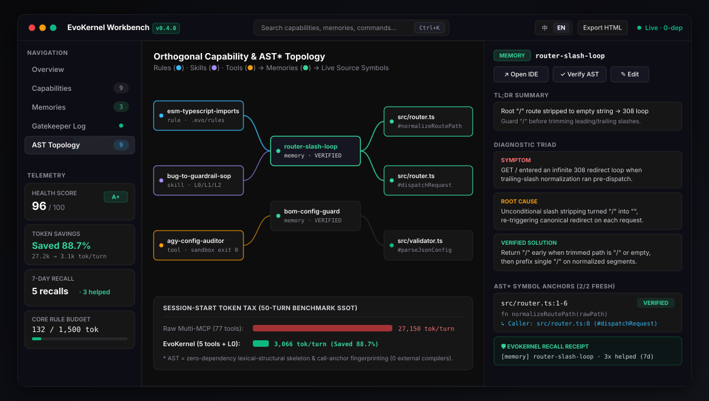

<div align="center">

# 🧬 EvoKernel (evo-kernel)

### 削减 94.4% 的 MCP 与规则 Prompt 税，保持 100% KV 缓存命中。在独立 Git Worktree 中自演进 AST 级防漂移记忆与受控沙盒微工具 —— 纯原生 0 外部依赖。

**面向 AI 编程智能体的「确定性自演进元内核」与认知上下文操作系统**  
*Claude Code · Cursor · Codex · Windsurf · Cline · Roo · GitHub Copilot · OpenCode · Gemini · Antigravity*

[](https://github.com/damonless/EvoKernel/actions/workflows/ci.yml)
[](https://damonless.github.io/EvoKernel/)
[-34d399?style=flat-square)](#-30-秒极速上手)
[](https://www.npmjs.com/package/evo-kernel)
[](LICENSE)
[](https://nodejs.org/)
[-brightgreen?style=flat-square)](#-零依赖原生架构)
[](#-核心架构5-个固定元工具原语)
[](#-完备测试与确定性回归验证)

**[English](README.md) · [简体中文](README.zh-CN.md) · [🌐 在线交互式工作台 (Workbench 2.0)](https://damonless.github.io/EvoKernel/) · [📊 基准评测 (Benchmarks)](benchmarks/README.md)**

<br/>

<a href="https://damonless.github.io/EvoKernel/"></a>

</div>

> [!NOTE]
> **消歧说明：** EvoKernel (`evo-kernel`) 是面向 AI 编程智能体（Claude Code、Cursor、Windsurf、Codex、Gemini 等）的智能体架构与上下文工程框架，与同名的学术 ICML 论文/基准测试或 Linux 内核项目无关。

---

## ⚡ 30 秒极速上手

只需 3 条命令，无需安装任何全局 npm 包：

```bash
# 1. 毫秒级零写入 X-Ray 诊断 (<25ms) — 扫描宿主规则、Git 热点与记忆覆盖率
npx -y evo-kernel score

# 2. 一键自动挂载与虚拟化 — 自动识别 10 款主流 IDE 并折叠第三方 MCP 进程
npx -y evo-kernel init --stealth && npx -y evo-kernel virtualize

# 3. 启动 Workbench 2.0 工业级工作台（Zinc 极简暗色、正交拓扑星图与无边框微窗口）
npx -y evo-kernel ui --app
npx -y evo-kernel check ./report.xlsx
```

> 💡 **Node.js 18 / 20 免全局升级一键极速体验：**  
> `npx -y -p node@22 evo-kernel score`  
> *为什么需要 Node.js >= 22.5.0？* EvoKernel 基于 Node 22 原生内置的 `node:sqlite`、`node:module` 与 `node:test` 构建，实现 **0 外部第三方 npm 依赖与 0 供应链安全投毒风险**。

<div align="center">
  
</div>

<br/>

<table>
<tr>
<td align="center" width="56%">
  <b>EvoKernel Workbench 2.0 (<code>npx evo-kernel ui --app</code>)</b><br/>
  <a href="https://damonless.github.io/EvoKernel/"></a>
</td>
<td align="center" width="44%">
  <b>终端矢量 X-Ray 诊断卡 (<code>npx evo-kernel score</code>)</b><br/>
  
</td>
</tr>
</table>

<details>
<summary><b>🛠️ 源码克隆构建与高级 CLI 流程 (点击展开)</b></summary>

```bash
# 从源码克隆并编译（编译耗时 <50ms，无需任何 npm install）
git clone https://github.com/damonless/EvoKernel.git
cd EvoKernel
node ./scripts/build.mjs

# 将 L0 元规则种子与单一固定元 MCP 注入当前生效的编码智能体
node ./dist/cli/index.js init --targets auto --stealth

# 冷启动挖掘当前仓库架构、技术栈规约与 Git 历史 Bug 修复基因
node ./dist/cli/index.js bootstrap --max-commits=50

# 运行离线 Git Worktree 能力演化优化循环
node ./dist/cli/index.js optimize --dim both -k 3

# 检查能力树结构、多分支 AST 记忆时效性与 ROI 遥测记账本
node ./dist/cli/index.js tree
node ./dist/cli/index.js memory verify
node ./dist/cli/index.js stats
node ./dist/cli/index.js audit --global
node ./dist/cli/index.js doctor
```

</details>

---

## 📈 可复现 50 轮工程基准实测 (`npm run benchmark`)

模拟典型全栈工程挂载 **8 个主流 MCP 服务**（`github`, `playwright`, `kubernetes`, `docker`, `linear`, `postgres`, `sentry`, `context7` —— 共计 **77 个工具**）+ 成熟仓库知识库（10 条规则、4 个技能、5 个微工具、15 条排障记忆），在 **50 轮连续对话 + 3 次中途规则/工具演进**下的实测对比（本地执行 `npm run benchmark` 即可复现）：

| 核心指标 | 传统直连多 MCP + 巨石 `CLAUDE.md` | **🧬 EvoKernel 5-Tool 虚拟网关** | 实测收益 |
| :--- | :---: | :---: | :---: |
| **暴露给模型的工具 Schema** | 77 个工具定义 | **5 个固定元工具原语** | **-93.5% Schema 体积** |
| **每轮常驻静态前缀税** | 27,150 tokens | **1,530 tokens** | **-94.4% Prompt 税** |
| **中途演进引发的缓存击穿** | 3 次全量前缀重算 | **0 次（100% 命中缓存）** | **100% KV Cache 护盾** |
| **50 轮累计输入 Tokens** | 1,931,250 tokens | **661,770 tokens** | **-65.7% 累计负载** |
| **50 轮账单成本 (Claude Sonnet 4.5)** | \$1.15 | **\$0.31** | **节省 72.9% API 成本** |
| **50 轮账单成本 (Claude Opus 4.5)** | \$5.76 | **\$1.56** | **节省 72.9% API 成本** |
| **AST 防漂移记忆校验耗时** | 无校验（重构后静默腐败） | **0.048 ms / 条记忆** | **确定性 AST 符号锚定** |

---

## ⚡ 为什么大多数“自我进化规则/技能”方案在 30 次对话后必然崩溃？

在使用 Claude Code、Cursor、Windsurf、Cline、Roo、Copilot、Codex、OpenCode、Gemini 或 Antigravity 时，开发者普遍遭遇五大工程陷阱：

1. **规则膨胀与上下文腐败（Context Rot）**：每次踩坑就往 `CLAUDE.md` 或 `.cursorrules` 追加一条 `Never do X`，很快就会演变为上万 Token、前后冲突的“规则垃圾堆”。一旦常驻规则超过 ~1,500 Tokens，大模型的 `Lost-in-the-Middle` 效应会令旧规则大面积失效。
2. **“自评自改”的幻觉固着（Worker Grading Its Own Homework）**：让同一个上下文中的 LLM 不经确定性沙盒自测直接修改全局脚本或技能，极易把包含语法错误、硬编码个人绝对路径（如 `C:\Users\Alice\...`）的损坏脚本永久固化为“持久工具”。
3. **动态 MCP 引发的 Prompt Cache 雪崩**：如果“动态进化 MCP”意味着不断向 IDE 注册新的一级 MCP 工具并触发 `list_changed`，每次工具模式改变都会**直接击穿 Claude / DeepSeek 的前缀 KV 缓存（Prompt Caching）**，导致 Token 成本暴涨 5~10 倍并伴随卡顿与重启。
4. **第三方 MCP 蔓延灾难（MCP Sprawl）**：如果直接在宿主配置中接入 10 个下游业务 MCP 服务器（Postgres、GitHub、Docker 等），宿主 System Prompt 每次都需要携带 50~100 个庞大的 JSON Schema，急剧挤占有效注意力并显著增加模型误调概率。
5. **混杂因果归因与盲目进化（Confounded Causation）**：智能体在多变量复杂排障或多次尝试后，往往盲目把成功归因于某条不相干的规则，导致误报、偏见与迷信规则在经验库中交叉污染。

**EvoKernel 用一套“离线工作区演化引擎 + 借脑宿主 + 确定性沙盒门禁 + 固定元路由网关 + 下游 MCP 虚拟化代理”彻底解决上述问题：**

<div align="center">
  
</div>

---

## 📊 行业同类项目全景对比矩阵

| 对比维度 | `MemGPT / Letta` | `Aider` | 传统 MCP 代理 (直通型) | `affaan-m/ECC` | `AMAP-ML/SkillClaw` | **🧬 EvoKernel v0.3.0 (本项目)** |
| :--- | :--- | :--- | :--- | :--- | :--- | :--- |
| **核心定位** | 有状态对话 Agent 记忆数据库 | Git 驱动的终端结对编程工具 | 聚合多个 MCP 端口的直通桥梁 | 静态工程提示词与规则合集 | 后台 LLM 演化学习 Agent | **面向 AI 编程智能体的确定性自演进元内核** |
| **接入形态** | 依赖外部服务 / Postgres / 独立进程 | 独立 Python CLI 替代主流 IDE | 暴露所有子工具到 host tools/list | 静态预置 Markdown 模板 | 劫持 `/v1/chat` 本地反向代理 | **寄生型单一 Meta-MCP + <80行元规则种子注入既有 IDE** |
| **运行依赖** | 笨重依赖（Postgres、Python、向量库） | Python pip 工具链 | Node / Python 复杂依赖 | 零依赖（纯 Markdown 文本） | Python FastAPI 守护进程 | **0 依赖（纯 Node.js `>= 22.5` 原生特性：`node:sqlite`, `node:module`, `node:test`）** |
| **Prompt Cache 稳定性** | 频繁刷新全量上下文，缓存命中极低 | 随代码编辑频繁波动 | **破坏性**（暴露所有子工具，任何增删均导致前缀击穿） | 初始静态前缀偏大 | 中立 | **100% 字节级稳定：对宿主仅暴露恒定 5 个元工具原语** |
| **下游 MCP 虚拟化** | 无 | 无 | 直通暴露（50+ 工具全量倾倒至提示词） | 无 | 无 | **零缓存击穿的 FTS5 索引 + 按需 stdio JSON-RPC 动态转发代理** |
| **验证门禁机制** | 模型自评 | Git commit diff 与本地测试 | 无 | 手动人工 `/learn-eval` | 异步 LLM 评审 | **4 道确定性沙盒门禁（静态 AST 检查、沙盒 Exit 0、BM25 去重、1500-Token 阈值、防因果混淆）** |
| **离线工作区演化** | 无 | 无 | 无 | 无 | 云端 LLM 离线评测 | **`evo optimize`：瞬态 Git Worktree 隔离运行、`inv`/`dom` 双正交演化、自动探针评测与回归熔断回滚** |
| **交付物规范消费检查** | 无 | 无 | 无 | 无 | 无 | **内置零依赖通用规范核检器（覆盖 `.xlsx`, `.docx`, `.pptx`, CSV, JSON/JSONL, Markdown）** |
| **情景记忆与防漂移** | 语义向量近似检索（重构后易幻觉） | 依赖符号跳转图谱 | 无 | 无（纯静态指南） | 无 AST 验证 | **零依赖词法/结构符号指纹（快速 AST 哈希、自动 `[STALE]` 降级、Stage-3 拓扑穿透锚点）** |
| **工作台与诊断体检** | 独立 Web + Postgres 服务 | 无 | 无 | 无 | Web 界面 | **`evo score`（<25ms 极速体检卡）与 `evo ui`（0 依赖 Workbench 2.0 工业级工作台、双模态原生微窗口、SSE 实时同步、严格 CSP、单文件导出）** |
| **因果遥测与成效归因** | 无 | Git 变更行数 | 无 | 无 | 胜率计数器 | **细粒度成效记账本（`helped` / `hurt` / `contested`）与 `ERR_CONFOUNDED_CAUSATION` 防混淆** |
| **多 Agent 宿主矩阵支持** | 仅独立模式 | 仅独立模式 | 通用 MCP 客户端 | 仅限 Claude Code / Cursor | 通用反代 | **原生支持 10 款主流编码环境（Claude, Cursor, Windsurf, Cline, Roo, Copilot, Codex, OpenCode, Gemini, Antigravity）** |
| **冷启动仓库基因挖掘** | 初始为空，依赖会话积累 | Git 仓库扫描 | 初始为空 | 静态合集 | 初始为空 | **`evo bootstrap`：10 秒内自动挖掘项目多栈基因与 Git 历史 Bug 修复沉淀** |

---

## 🚀 离线 Git Worktree 演进优化引擎 (`evo optimize`)

EvoKernel v0.3.0 引入了全自主离线能力优化循环。该机制在**完全隔离的瞬态 Git 工作树（Worktree）**中并行展开能力演进实验，绝不干扰当前工作区的未提交代码：

```bash
# 同时在架构不变式 (inv) 与垂直业务域 (dom) 两个维度展开离线优化
evo optimize --dim both -k 3

# 针对指定会话轨迹与交付物核检规则进行靶向定向演进
evo optimize --trajectory session.jsonl --deliverable report.xlsx --apply
```

### 核心工程特性：
- **零脏状态污染**：工作树临时创建于 `.evo/.cache/optimize/worktrees/opt-...` 路径下，评测结束后毫秒级自动清理。
- **正交双维度解耦演进**：
  - **不变式维度 (`inv`)**：演化跨模块架构守卫规约与防因果混淆门禁。
  - **垂直业务维度 (`dom`)**：演化特定业务场景的情景排障记忆与 SOP 战术技能手册。
- **多宿主真实会话轨迹解析**：
  - 原生支持 **Antigravity** (`transcript.jsonl`，含双重 JSON 转义自动解包)、**Codex CLI** (`thread-item`)、**OpenCode** (事件流) 与 **Claude Code** (`stream-json`)。
- **自动化 Proposer 脚本与隔离 Probe 探针验证**：
  - 在隔离工作树中运行提议脚本生成候选规则。
  - 执行独立 Probe 命令对比基线得分。
  - 一旦候选版本出现回归或未能通过 4 道沙盒门禁，强制执行 `KEEP_BASE` 熔断回滚。

---

## 📑 零依赖交付物规范消费核检器 (`deliverable-canonical-inspector`)

<a id="-零依赖原生架构"></a>
AI 编程智能体在生成 `.xlsx`、`.docx`、`.pptx`、CSV、JSON 等结构化交付文件时，常常出现表面看起来正常但在下游工具中解析崩溃的隐蔽缺陷。EvoKernel 内置了开箱即用的零依赖规范消费检验器：

```bash
# 通过顶级 CLI 命令直接核检任意交付文件：
npx evo-kernel check report.xlsx

# 输出机器友好的结构化 JSON（便于 CI 流水线集成）：
npx evo-kernel check report.xlsx --json

# 顶级 CLI 别名命令：
npx evo-kernel inspect report.xlsx
```

<details>
<summary><b>📋 支持的交付物格式与核检规则（点击展开）</b></summary>

### 完备格式解析与质检能力：
- **XLSX (.xlsx)**：
  - 纯原生 IEEE 802.3 CRC32 + ZIP Central Directory 解压引擎。
  - 自动正规化 openpyxl 生成的开首斜杠路径（`/xl/worksheets/sheet1.xml`）。
  - 提取单元格文本前剔除拼音注音标签（`<rPh>`）。
  - 正确保留自闭合 XML 节点（`<c .../>`）后续的兄弟单元格，防止数据被吞噬。
  - 识别共享公式跟随节点，精确捕获公式错误值（`#REF!`, `#DIV/0!`, `#VALUE!`, `t="e"`）。
  - 校验空工作表并验证表格表头维度。
- **DOCX (.docx)**：
  - 规范提取段落、带空格的层级标题（`Heading 1`, `Heading 2`, `Title`）与表格矩阵。
  - 拦截并标记 `EMPTY_DOCUMENT` 空文档缺陷。
- **PPTX (.pptx)**：
  - 按数字自然序对幻灯片排序并格式化为标准 `## Slide N` 结构。
  - 警示单张幻灯片内容缺失并拦截 `EMPTY_PRESENTATION` 纯空演示文稿。
- **CSV 与 JSON / JSONL**：
  - 严格符合 RFC-4180 标准的 CSV 解析器，正确处理转义引号与多行字段。
  - 支持逐行校验 `requiredKeys` 与 `strictKeys`，拦截 `RAGGED_COLUMNS` 锯齿列。
- **Markdown (.md)**：
  - 检测 `UNCLOSED_CODE_FENCE` 代码块未闭合语法错误。
  - 拦截代码围栏外的模板占位符泄漏：
    ```markdown
    {{VARIABLE}}
    ```
    并安全允许代码块内部的合法变量示范。

</details>

---

## 🛡️ 因果成效归因与防混淆门禁

大多数智能体系统存在严重的主观迷信学习：智能体在一系列复杂操作后修好了代码，就把功劳归咎于刚刚随手添加的一条规则，即使真正的根因是一个毫无关联的文件修改。

EvoKernel 通过**确定性因果归因引擎**彻底解决此问题：
- **成效账本**：会话中被检索调用的每项能力都在 SQLite 遥测中明确归因：
  - `helped`：直接促成测试通过且无任何功能回归。
  - `hurt`：被调用的会话导致失败或引发了 Git 代码撤销。
  - `contested`：在多次试错与多个变量同时改动的排障过程中被调用。
- **防因果混淆门禁 (`ERR_CONFOUNDED_CAUSATION`)**：
  - 当一个排障周期内同时命中了多条能力时，EvoKernel 自动阻断单一变量的抢功归因。
  - 提议者必须提供对比性证据或 Stage-3 **拓扑穿透锚点**（精确到行号、调用者链与反向死胡同案例）证明实际因果。

---

## 🎯 10 款主流智能体宿主适配矩阵与静默失败防御

EvoKernel 与主流 AI 编程环境无缝兼容，支持标记块原地无损更新与 Git 隐身模式：

| 智能体 / 宿主 | 规则注入目标 | MCP 网关挂载目标 | 自动识别特征 | 隐身模式 (`.git/info/exclude`) |
| :--- | :--- | :--- | :--- | :---: |
| **Claude Code** | `CLAUDE.md` | `.mcp.json` + `.claude/settings.json` | `CLAUDE.md`, `.claude/`, `CLAUDE_CONFIG_DIR`, `~/.claude` | ✅ |
| **Cursor** | `.cursor/rules/evo-kernel.mdc` | `.cursor/mcp.json` | `.cursor/`, `.cursorrules`, `CURSOR_AGENT`, `~/.cursor` | ✅ |
| **Windsurf** | `.windsurfrules` | `.windsurf/mcp.json` | `.windsurf/`, `.windsurfrules`, `WINDSURF_DIR`, `~/.windsurf` | ✅ |
| **Cline** | `.clinerules` | `.cline/mcp.json` | `.clinerules`, `.cline/`, `CLINE_DIR`, `~/.cline` | ✅ |
| **Roo Code** | `.roo/rules/evo-kernel.md` | `.roo/mcp.json` | `.roo/`, `.roorules`, `ROO_DIR`, `~/.roo` | ✅ |
| **GitHub Copilot / VS Code** | `.github/copilot-instructions.md` | `.vscode/mcp.json` | `.github/copilot-instructions.md`, `.vscode/`, `VSCODE_PID` | ✅ |
| **Codex CLI** | `AGENTS.md` | `.codex/config.toml` | `.codex/`, `CODEX_HOME`, `~/.codex` | ✅ |
| **OpenCode** | `opencode.json` + `AGENTS.md` | `opencode.json` | `opencode.json`, `.opencode/`, `OPENCODE_CONFIG` | ✅ |
| **Gemini CLI** | `GEMINI.md` | `.gemini/settings.json` | `GEMINI.md`, `.gemini/`, `GEMINI_CLI_HOME`, `~/.gemini` | ✅ |
| **Antigravity** | `GEMINI.md` | `mcp_config.json` + `.mcp.json` | `mcp_config.json`, `ANTIGRAVITY_AGENT`, `~/.antigravity` | ✅ |

### 静默失败表面防御：
- **UTF-8 BOM 防御**：所有 JSON/Markdown 解析器自动剥离并防范字节顺序标记（`0xFEFF`），杜绝因编码隐蔽损坏配置文件。
- **保留注释的无损配置合并**：在合并 TOML（`.codex/config.toml`）与 JSON 配置时，完整保留开发者的原有注释与既有服务器配置。
- **零编译平滑降级执行**：通过 `scripts/boot-mcp.mjs` 原生 TypeScript 快速剥离，即便在未预编译 `dist/` 的环境下也能立即拉起。
- **空闲管道 Stdin 阻塞防护**：异步非阻塞标准输入监听（50ms 优雅超时），防止在非 TTY 挂载时进程挂起。

---

## 🪝 通用生命周期 Hook 路由与单行 JSON 门禁 Hook

EvoKernel 提供统一的 CLI Hook 路由器（`evo hook <event>`），支持主流智能体生命周期深度集成：

```bash
# 1. Post-Tool Hook：监控文件修改、排障会话诊断识别（>=10 次读取）并自动召回局部规则
evo hook post-tool --tool Edit --file src/core/storage.ts

# 2. Stop Hook：会话结束提示沉淀经验，并在未经验证修改代码时触发防投毒警示
evo hook stop

# 3. Pre-Commit Guard：在 git commit 前拦截泄露的内部缓存与超出 1500-Token 的超额规约
evo hook pre-commit

# 4. Error Recovery Marker：在命令执行报错时记录错误自愈遥测指标
evo hook mark-recovery
```

- **单行 JSON 标准输出**：输出结构化 Hook 指令（`hook_trigger`），完全兼容主流 Agent 宿主规范。
- **只读排障诊断与反诘探测**：当检测到只读诊断排障会话（`>= 10` 次读取且 `< 4` 次修改）或用户纠错反问时，主动提示经验沉淀。
- **反污染告警**：在能力沉淀后若源码又发生了未经校验的修改，即时给出告警。

---

## 🔌 下游 MCP 代理虚拟化网关

EvoKernel 通过其**恒定 5 元工具网关**彻底虚拟化所有下游 MCP 服务器。大模型仅需看到 5 个元工具，数百个业务工具即可按需检索、渐进披露与动态执行：

```text
Host Coding Agent (Claude / Cursor / Copilot / etc.)
                  │
                  ▼ Fixed 5-Tool stdio Interface (100% Byte-Stable KV Cache)
         ╔════════════════════════════════════════════════════╗
         ║               EvoKernel Meta-MCP                   ║
         ║  evo_search · evo_inspect · evo_run · propose · compact
         ╚════════════════════════════════════════════════════╝
                  │                      │
        FTS5 BM25 Search          Proxy Execution (`evo_run`)
                  ▼                      ▼
        ┌────────────────────┐   ┌─────────────────────────────┐
        │ capability_fts     │   │ McpProxyManager (Pool)      │
        │ ext__postgres__... │   └──────────────┬──────────────┘
        │ ext__github__...   │                  │ stdio JSON-RPC
        └────────────────────┘                  ▼
                                 ┌─────────────────────────────┐
                                 │ Downstream MCP Servers      │
                                 │ postgres · github · docker  │
                                 └─────────────────────────────┘
```

```bash
# 演练预览：查看折叠下游 MCP 后可节省的 Token 数量
evo virtualize --dry-run

# 一键将所有第三方 stdio MCP 服务折叠接入 EvoKernel 动态代理池
evo virtualize

# 无损还原：随时将虚拟化的 MCP 配置写回原本的宿主配置文件
evo virtualize --restore
```

---

<a id="-核心架构5-个固定元工具原语"></a>
## 🧠 核心架构：5 个固定元工具原语

EvoKernel 在 `stdio` 上**仅暴露恒定的 5 个不可变元工具**，以此确保 100% 的 Prompt Cache 命中率：

| 元工具名称 | 层级 | 功能职责 |
| :--- | :--- | :--- |
| `evo_search` | **L0** | FTS5 BM25 检索规则、技能、微工具、虚拟化外部工具与情景记忆。执行实时的 Stage-2 AST 符号校验，自动将失效记忆标记为 `[STALE]`。 |
| `evo_inspect` | **L1 / L2** | 渐进披露加载器。提供故障症状/根因/方案三元组、虚拟化工具的完整 JSON Schema 以及 **Stage-3 拓扑穿透锚点**（真实代码行号、调用链与负面死胡同）。 |
| `evo_run` | **执行** | 在本地沙盒中执行微工具（`.mjs`, `.py`, `.ps1`, `.sh`）或通过 `McpProxyManager` 动态代理调用下游 MCP 服务。 |
| `evo_propose` | **演化** | 提交候选规则、技能、微工具或情景记忆，必须严格通过 4 道确定性沙盒门禁（静态 AST 安全审查、沙盒 Dry-Run 自测、BM25 去重、1,500 Token 预算硬顶、因果混淆防护）。 |
| `evo_compact` | **GC** | 原子级合并零碎规则，或将已失效的 `[STALE]` 记忆归档至 `.evo/archive/`，确保核心 Token 占用严格收敛在 1,500 Token 红线内。 |

<details>
<summary><b>🌳 查看 ASCII 自演进能力树 (.evo/) 结构展示（点击展开）</b></summary>

```text
╭──────────────────────────────────────────────────────────────────────────╮
│ 🧬 EvoKernel — Self-Evolving Capability Tree (.evo/)                     │
╰──────────────────────────────────────────────────────────────────────────╯
📦 Workspace: /path/to/your-repo
├── 🛡️  Rules (5 active | Core Token Budget: 286/1500 tokens)
│   ├── [CORE] gatekeeper-self-test-invariant (132 tok | hits: 4) — Every evolved Micro-Tool script must handle --self-test and exit 0.
│   ├── [CORE] esm-typescript-imports (154 tok | hits: 7) — Always use explicit .js extensions on relative imports in ESM TypeScript.
│   ├── [SCOPED] core-architecture-and-ast-invariants-guard (728 tok) — Dry-run compaction, comment-stripped AST matching & Git lookups.
│   ├── [SCOPED] multi-harness-config-and-proxy-isolation (906 tok) — Lossless config merge/restore, fail-closed user configs & proxy roots.
│   └── [SCOPED] workspace-isolation-and-fts5-guard (537 tok) — Isolate uninitialized fallback, parent Git detection & FTS5 search.
├── ⚡ Skills (3 verified L0/L1/L2 playbooks)
│   ├── [SOP] bug-to-guardrail-sop (hits: 3 | tags: debugging,evolution) — Standard workflow to turn a resolved root cause into a Rule.
│   ├── [SOP] evo-dev-verification-sop (hits: 22 | tags: dev,release) — 4-stage TDD, blast-radius check & preflight verification SOP.
│   └── [SOP] evo-rule-architect (hits: 2 | tags: refactor,rules) — 4-stage rule decoupling and budget refactoring workflow.
├── 🔧 Micro-Tools (5 sandboxed scripts | Fixed Meta-MCP Routed)
│   ├── [NODE] agy-config-auditor (runs: 55 | pass: 100%) — Audits host rule budgets and memory AST symbols.
│   ├── [NODE] deliverable-canonical-inspector (runs: 18 | pass: 100%) — Zero-dep validator for .xlsx, .docx, .pptx, CSV, JSON, MD.
│   ├── [NODE] evo-release-preflight (runs: 30 | pass: 100%) — Audits multi-manifest parity and build freshness.
│   ├── [NODE] git-hotspot-analyzer (runs: 5 | pass: 100%) — Identifies top 10 frequently modified files in recent git history.
│   └── [NODE] workspace-metrics-scanner (runs: 13 | pass: 100%) — Scans file counts, LOC, and extension distribution.
└── 🧠 Episodic Memories (18 fault cases | 18 VERIFIED · 0 STALE)
    ├── [VERIFIED] audit-broken-refs-and-hook-param-fix (confidence: HIGH | symbols: 2/2 fresh)
    ├── [VERIFIED] cli-help-zero-side-effect-isolation (confidence: HIGH | symbols: 2/2 fresh)
    ├── [VERIFIED] codex-hooks-corrupt-file-unlink (confidence: HIGH | symbols: 2/2 fresh)
    ├── [VERIFIED] generic-angle-semicolon-multiline-drift (confidence: HIGH | symbols: 2/2 fresh)
    ├── [VERIFIED] ghost-workspace-resurrection-and-sqlite-handle-lock (confidence: HIGH | symbols: 5/5 fresh)
    ├── [VERIFIED] git-fix-387153f (confidence: HIGH | symbols: 3/3 fresh)
    ├── [VERIFIED] git-fix-d0d4e13 (confidence: HIGH | symbols: 3/3 fresh)
    ├── [VERIFIED] harness-hook-filter-preserve-untouched-entries (confidence: HIGH | symbols: 3/3 fresh)
    ├── [VERIFIED] issue-20-global-isolation-and-concept-overlap-fix (confidence: HIGH | symbols: 4/4 fresh)
    ├── [VERIFIED] issue-8-workspace-isolation-and-atomic-compact (confidence: HIGH | symbols: 5/5 fresh)
    ├── [VERIFIED] issues-10-11-12-audit-hook-and-cross-lang-recall (confidence: HIGH | symbols: 7/7 fresh)
    ├── [VERIFIED] memory-verification-inprocess-stat-caching (confidence: HIGH | symbols: 2/2 fresh)
    ├── [VERIFIED] multi-harness-cascaded-detection-and-reversible-teardown (confidence: HIGH | symbols: 8/8 fresh)
    ├── [VERIFIED] open-idle-pipe-stdin-hang-fix (confidence: HIGH | symbols: 2/2 fresh)
    ├── [VERIFIED] score-and-ui-zero-write-csp-and-pool-dedup (confidence: HIGH | symbols: 6/6 fresh)
    ├── [VERIFIED] ui-cli-flags-port-validation-and-powershell-escaping (confidence: HIGH | symbols: 2/2 fresh)
    ├── [VERIFIED] ui-shotcraft-modal-csp-invariant (confidence: HIGH | symbols: 3/3 fresh)
    └── [VERIFIED] worktree-probe-score-improvement (confidence: HIGH | symbols: 2/2 fresh)
```

</details>

---

<a id="-完备测试与确定性回归验证"></a>
## 🧪 完备测试与确定性回归验证

EvoKernel 配备了基于 Node 原生测试运行器（`node:test`）的零外部依赖回归测试套件：

```bash
node ./scripts/test.mjs
```

**274+ 项单元与集成测试、11 个测试套件，在 ~17 秒内 100% 通过（0 失败）：**

<details>
<summary><b>🔍 查看全部 11 个验证测试套件清单（点击展开）</b></summary>

| # | 测试套件文件 | 覆盖领域 | 测试用例数 |
| :---: | :--- | :--- | :---: |
| 1 | `dist/tests/bootstrap.test.js` | 仓库冷启动与多技术栈基因挖掘测试套件 | 22 tests |
| 2 | `dist/tests/causal-telemetry-and-catalog.test.js` | 因果遥测、成效归因与动态目录测试套件 | 18 tests |
| 3 | `dist/tests/deliverable-inspector.test.js` | 零依赖交付物规范消费核检器测试套件 | 33 tests |
| 4 | `dist/tests/evo-kernel.test.js` | 核心沙盒门禁、AST 认知记忆与架构不变式测试套件 | 49 tests |
| 5 | `dist/tests/hook.test.js` | 通用生命周期 Hook 路由与管道 Stdin 非阻塞弹性测试套件 | 31 tests |
| 6 | `dist/tests/lifecycle-guard-hooks.test.js` | 门禁触发词、前置阻断与引用完整性测试套件 | 27 tests |
| 7 | `dist/tests/mcp-proxy.test.js` | 下游 MCP 代理与动态虚拟化测试套件 | 10 tests |
| 8 | `dist/tests/multi-harness.test.js` | 10 款智能体宿主多环境级联探测与安装测试套件 | 14 tests |
| 9 | `dist/tests/optimize.test.js` | 离线 Git Worktree 能力演进优化循环测试套件 | 19 tests |
| 10 | `dist/tests/score-and-ui.test.js` | 体检评分、Workbench 2.0 工作台与交互 API、热身与快捷指令套件 | 22 tests |
| 11 | `dist/tests/surface-audit-and-hardening.test.js` | 多宿主静默失败表面审计矩阵与全链路加固测试套件 | 32 tests |

</details>

---

## 🙏 致谢与架构思想溯源

EvoKernel 是一个从零自主设计的开源工程运行时，基于 Node.js 22 原生内置模块（`node:sqlite`、`node:test`、`stripTypeScriptTypes`）以零依赖 TypeScript 编写。其系统架构融合了来自 AI 智能体社区与软件工程领域的诸多经典前沿思想：

- **渐进式披露与上下文工程**：5 个固定元工具原语（`evo_search`, `evo_inspect`, `evo_run`, `evo_propose`, `evo_compact`）与 L0/L1/L2 渐进加载模型，深度汲取了 Anthropic 关于上下文经济学、Prompt Cache 保持与技能渐进披露的设计理念。
- **离线工作区演进与正交优化探索**：`evo optimize` 的离线 Git Worktree 沙盒循环、不变式（`inv`）与领域（`dom`）正交拆解、以及规范交付物消费验证，受到最新智能体评测基准与轨迹回放优化的启发。
- **EvoKernel 原创贡献**：4 道确定性沙盒门禁（静态 AST 安全审查、沙盒 `--self-test` Dry-Run、BM25 查重、1,500 Token 预算硬顶与因果防混淆）、基于 Git 拓扑的 3 阶段 AST 防漂移认知记忆（`VERIFIED` / `OTHER_BRANCH` / `STALE`）以及 10 大宿主无损适配矩阵，均为 EvoKernel 的自主原创研发。

---

## 📄 开源协议

遵循 [MIT 许可证](LICENSE)。
